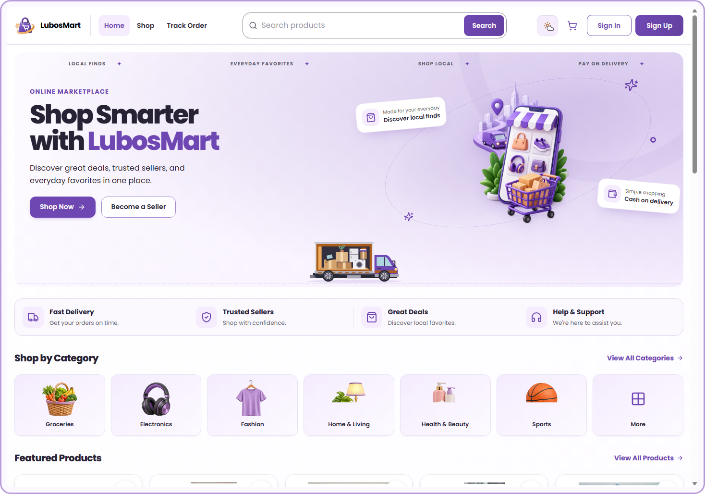
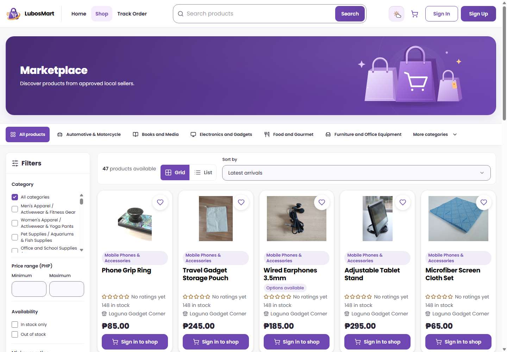

<div align="center">


# LubosMart

**Local shopping. Connected delivery.**

A marketplace for Filipino communities, from the first product search to the final delivery and cash handover.

[](web/composer.json)
[](web/package.json)
[](web/package.json)
[](web/package.json)
[](web/package.json)

[Visit LubosMart](https://lubosmart.app) · [Features](#features) · [Setup](#setup) · [Screenshots](#screenshots) · [Documentation](#documentation)

</div>

---

<a id="overview"></a>

## What is LubosMart?

LubosMart brings **Buyers, Sellers, Riders, Logistics teams and Admins** into one e-commerce and delivery platform. Buyers shop from local stores, Sellers prepare orders, and delivery teams move each parcel through scanning checkpoints and proof of delivery. Cash handovers, returns and Seller settlements stay connected to the original order.

The website runs on Laravel, React and Inertia.js. The backend owns authentication, permissions, stock, delivery rules and financial records. A separate Flutter client shares the versioned API; mobile interface development is currently paused while the team prepares a new Figma design.

<a id="workspaces"></a>

## Features

### Shopping and checkout

- **Find local products:** browse the marketplace, search by product, filter by category and view product details and reviews.
- **Choose and save:** select supported product options, manage a wishlist, update cart quantities and save delivery addresses.
- **Review the total:** see server-calculated shipping, apply eligible shop vouchers and opt into available Lubos Coins before checkout.
- **Place COD orders:** orders containing multiple stores become separate Seller parcels with their own tracking references.
- **Follow each parcel:** check order progress, view authorized delivery proof, message the Seller and rate delivered items.
- **Request help or returns:** use support conversations and submit eligible item quantities for review.

### Store operations

- **Manage a catalog:** maintain product photos, prices, options, stock, packed weight and listing visibility.
- **Work through order queues:** review new orders, prepare parcels and mark them ready for pickup.
- **Print waybills:** use the parcel's tracking identity for the existing scanning and delivery workflow.
- **Run store promotions:** manage shop vouchers with eligibility and usage rules checked at checkout.
- **Review store performance:** see sales, commission, proceeds, settlement history and supported cost records.
- **Handle customer follow-up:** keep order messages, support and physical returns attached to the relevant work.

### Delivery and logistics

- **Give Riders their assigned work:** pickup, dispatch, delivery and eligible return tasks follow server-enforced assignment rules.
- **Scan custody checkpoints:** record pickup, facility receipt and delivery-Rider handover against the parcel reference.
- **Capture delivery proof:** submit recipient information, fresh proof and COD confirmation through the supported delivery flow.
- **Manage a delivery operation:** Logistics teams maintain their Riders, coverage, shipping rates, sorting and dispatch queues.
- **Track cash separately:** record Rider cash handovers and Logistics reconciliation without treating delivered status as a cash receipt.

### Administration and shared account tools

- **Review applications and accounts:** required documents, verification and approval rules govern workspace access.
- **Moderate and resolve:** manage compliance, complaints, support and return/refund decisions.
- **Reconcile platform funds:** confirm financial records and eligible Seller settlement through the existing approval workflow.
- **Stay connected:** shared notifications, messaging, account settings, private document access and optional Google sign-in.
- **Keep permissions on the server:** each workspace receives only the data and actions its account is allowed to use.

Read the [workspace guide](documentation/WORKSPACES.md) for each role's requirements and supported actions.

<a id="from-checkout-to-delivery"></a>

## How it works

1. **Shop.** A Buyer chooses products and a delivery address. The server checks stock, vouchers, shipping and any selected Lubos Coins.
2. **Prepare.** Each Seller receives their part of the order, prepares a parcel and prints its waybill.
3. **Move.** The pickup Rider and Logistics team record custody as the parcel reaches the facility, sorting and delivery-Rider handover.
4. **Deliver.** The assigned Rider completes the delivery with recipient details, proof and confirmation of remaining COD when cash is due.
5. **Reconcile.** Rider and Logistics record actual cash handovers. Admin confirms reconciliation and platform receipt before eligible Seller settlement.

> **Returns and refunds:** reviewed separately from forward delivery. Approved refunds credit Lubos Coins; financial approval and physical return custody remain separate. Recorded settlement activity does not perform a bank transfer.

See [order, scanning and finance workflows](documentation/WORKFLOWS.md) for the complete rules.

## Setup

### Requirements

| Requirement        | Version or setup                                                                |
| ------------------ | ------------------------------------------------------------------------------- |
| PHP                | 8.2+ with Laravel's required extensions                                         |
| Composer           | 2                                                                               |
| Node.js            | 22 with npm                                                                     |
| Database           | Dedicated local database; SQLite or configured MySQL                            |
| Mobile development | Optional Flutter SDK compatible with [mobile/pubspec.yaml](mobile/pubspec.yaml) |

### First-time installation

Clone the repository, open `web/` and follow the [Web installation guide](documentation/SETUP.md#web). It covers dependencies, environment configuration, the application key and development database preparation.

Use a dedicated development database and synthetic accounts. Preserve existing environment files, application keys, customer data and private uploads when updating an existing installation.

<a id="run-locally"></a>

### Run locally on Windows

Once setup is complete:

1. Double-click **[Start LubosMart.cmd](Start%20LubosMart.cmd)** in the repository root.
2. The launcher starts **Laravel, Vite and the notification queue**, then opens the website automatically.
3. Keep its terminal open while working. Press **Ctrl+C** when you are done.

The launcher reads `web/.env` and expects a local HTTP `APP_URL` on port 8000. Ports 8000 and 5173 must be available. Your configured database must be running; the launcher can start a local MySQL/MariaDB Windows service when exactly one is found and Windows permits it. The database service stays running when you stop the app.

For launcher troubleshooting and other operating systems, see [local startup and manual commands](documentation/SETUP.md#development-website-and-shared-api).

### Configuration

| Area                            | Where to start                                                                              |
| ------------------------------- | ------------------------------------------------------------------------------------------- |
| Database, sessions and queues   | [Environment configuration](documentation/SETUP.md#environment)                             |
| Mail and Google sign-in         | [Provider setup](documentation/SETUP.md#environment-mail-and-google-login)                  |
| Production services and backups | [Deployment and operations](documentation/DEPLOYMENT.md)                                    |
| Mobile API connection           | [Flutter setup](documentation/SETUP.md#flutter) and [API guide](documentation/api/GUIDE.md) |

The Flutter source and API integration remain available as a reference. Its current screens are provisional while the new mobile Figma design is prepared; see the [mobile README](mobile/README.md).

## Screenshots

The following captures show the actual public LubosMart website. Click an image to open it at full size.

### Homepage

The public storefront introduces LubosMart, product categories and local shopping.

[](documentation/assets/readme/homepage.png)

### Marketplace

Product discovery with category navigation, search and listing cards.

[](documentation/assets/readme/marketplace.png)

Capture details are recorded with the [screenshot assets](documentation/assets/readme/README.md). Screenshots illustrate the interface; product availability and displayed content can change.

## Technology

| Layer                 | Stack                                                     |
| --------------------- | --------------------------------------------------------- |
| Website               | React 19, TypeScript, Inertia.js 2                        |
| Interface             | Tailwind CSS 4, Radix UI, Lucide                          |
| Backend               | Laravel 12, PHP 8.2+, Eloquent                            |
| Shared API            | Versioned JSON endpoints, Laravel Sanctum                 |
| Data                  | MySQL; SQLite supported for local development             |
| Build tools           | Vite 6, Node.js 22, npm                                   |
| Mobile                | Flutter and Dart; UI work paused pending new Figma design |
| Hosting configuration | Docker Compose, Apache and Caddy                          |

## Repository

```text
lubosmart-app/
├── web/                  Website, shared API, backend tests and Docker files
├── mobile/               Flutter reference client and Android helper scripts
├── documentation/        Product guides, API contracts, screenshots and standards
├── scripts/              Local development launcher
├── .agents/              Agent instructions and reusable workflows
├── .github/              Repository automation
├── Start LubosMart.cmd   Windows local startup
└── README.md
```

Run PHP, Composer, npm and Docker commands from `web/`; run Flutter commands from `mobile/`.

## Documentation

| Guide                                                    | Contents                                                  |
| -------------------------------------------------------- | --------------------------------------------------------- |
| [Documentation index](documentation/README.md)           | Starting points, standards and dated reviews              |
| [Workspaces](documentation/WORKSPACES.md)                | Buyer, Seller, Rider, Logistics and Admin capabilities    |
| [Workflows](documentation/WORKFLOWS.md)                  | Orders, scanning, COD, returns, vouchers and approvals    |
| [Setup and development](documentation/SETUP.md)          | Installation, local startup and environment configuration |
| [Architecture](documentation/ARCHITECTURE.md)            | System structure, backend boundaries and database         |
| [Frontend](documentation/FRONTEND.md)                    | Shared components and screen-to-source map                |
| [API](documentation/api/GUIDE.md)                        | Authentication, endpoints and integration contracts       |
| [Deployment and operations](documentation/DEPLOYMENT.md) | Production topology, backups and release procedures       |

<a id="contributing"></a>

## Contributing and support

- **Bugs and feature requests:** use [GitHub Issues](https://github.com/carlmatthewcastro/lubosmart-app/issues). Describe what happened, what you expected and how to reproduce it. Remove account details and private documents from attachments.
- **Code contributions:** follow the [Git workflow](documentation/standards/GIT_WORKFLOW_RULES.md) and [UI/UX standards](documentation/standards/UI_UX_RULES.md). Keep changes focused and include relevant validation.
- **Agent-assisted work:** start with [AGENTS.md](AGENTS.md) and follow the repository's shared instructions.
- **Sensitive reports:** contact the repository owner privately. Keep credentials, tokens and private evidence out of public issues.

---

<div align="center">

**LubosMart** · Connecting local stores, communities and delivery teams.

[Website](https://lubosmart.app) · [Documentation](documentation/README.md) · [Run locally](#run-locally-on-windows)

</div>
