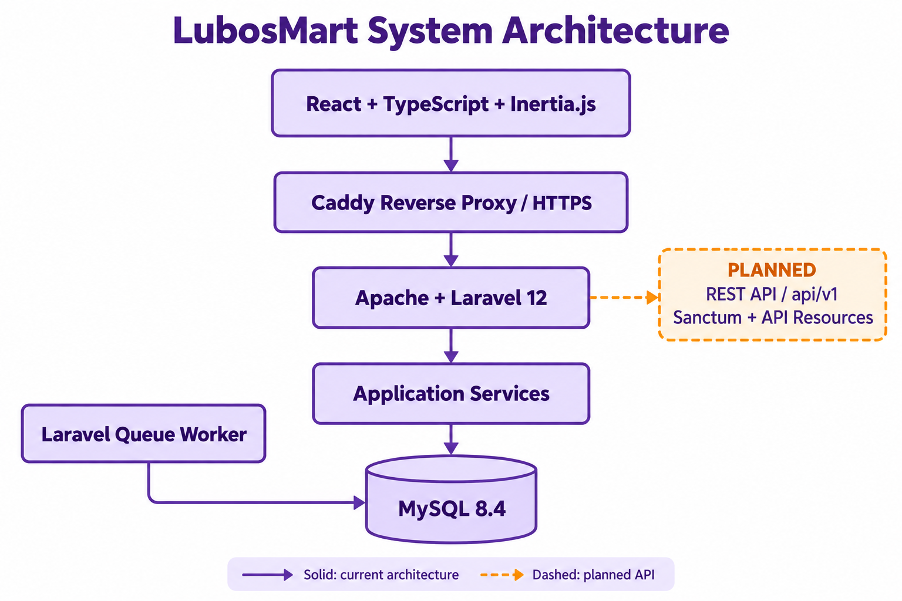

# LubosMart

**A Community-Focused E-Commerce and Logistics Management Platform**

LubosMart is an e-commerce and delivery management platform for Filipino communities. It connects buyers, sellers, riders, logistics companies and administrators in one system, covering product discovery, cash-on-delivery checkout and parcel fulfillment.

**Live application:** [lubosmart.app](https://lubosmart.app)

## Technology Stack

| Layer | Technologies |
| --- | --- |
| Front End | React 19, TypeScript, Inertia.js 2, Tailwind CSS 4, Radix UI, Headless UI |
| Backend | Laravel 12, PHP 8.3 in Docker, Apache, Laravel Socialite |
| Database | MySQL 8.4 in Docker Compose, Eloquent ORM |
| Mobile | Flutter/Dart native client, HTTP API, secure token storage |
| Build and Testing | Vite 6, Node.js 22, Composer, Pest, GitHub Actions |
| Deployment | Docker Compose, Caddy; Azure Ubuntu VM and Cloudflare DNS documented in the deployment setup |

## Features by Role

| Role | Main Functions |
| --- | --- |
| Buyer | Browse and search products, manage cart and addresses, place COD orders, track deliveries and contact sellers/support |
| Seller | Manage listings, prices and stock; prepare orders, print waybills, follow shipments and review sales |
| Rider | Handle assigned pickups and deliveries, update parcel status, upload proof of delivery and confirm COD collection |
| Logistics | Review riders, manage shipping coverage/rates, receive and sort parcels, assign deliveries and receive COD handovers |
| Admin | Review applications, manage account restrictions, monitor seller compliance, resolve complaints, reconcile COD and manage reports/platform content |

Public accounts require email verification and application approval before operational access. Admin reviews buyer, seller and logistics applications; logistics companies review their riders. Email/password and Google sign-in are supported.

## How the System Works

A buyer's checkout creates separate orders for each seller. Sellers prepare the parcels, logistics companies coordinate pickup and dispatch, and riders complete delivery with proof and COD collection. Logistics companies receive the cash; Admin performs final reconciliation.



This baseline diagram predates the November 5, 2026 API work. Its dashed REST API branch is now implemented locally for the core mobile commerce/custody workflows; see the [current API coverage](documentation/api/README.md).

The application uses a Laravel modular monolith: one backend owns the account, commerce, logistics and administration modules. Inertia connects React pages and forms to Laravel. Checkout preserves order details, checks stock and protects against duplicate submissions. Queue workers process operational notifications.

## Repository Map

Laravel and the integrated web frontend stay at the repository root. Flutter lives in `apps/mobile`; both clients share Laravel business rules and database data.

| Location | Purpose |
| --- | --- |
| `app/` | Backend controllers, models, policies, requests, services and actions; versioned API controllers are in `app/Http/Controllers/Api/V1` |
| `routes/` | Web/auth/account/settings routes; `api.php` includes `mobile.php` for `/api/v1` |
| `resources/js/` | React entrypoints, hooks, types and utilities |
| `resources/views/` | Inertia React pages, components and layouts, plus Blade/mail templates; Vite and TypeScript aliases intentionally point here |
| `resources/css/`, `resources/data/` | Web styles and reference data |
| `database/`, `config/`, `bootstrap/` | Migrations/factories/seeders, configuration and application bootstrapping |
| `public/`, `storage/` | Web document root and runtime/private uploads; uploaded data is not disposable build output |
| `apps/mobile/` | Flutter `lib`, assets, Android/iOS projects and `test` |
| `tests/` | Laravel Feature/Unit tests, fixtures and Node web/API harnesses |
| `documentation/` | Canonical guides, standards, [requirements and evidence](documentation/requirements/ACCOUNT_CREATION_AUDIT.md), API contracts and acceptance plans |
| `scripts/`, `.github/workflows/` | Development utilities and CI |

Root Composer/npm manifests, Vite/TypeScript configuration and Docker files belong to the Laravel application. `vendor`, `node_modules`, `.tools`, build outputs and caches are local dependencies/artifacts; do not move them into application source or commit them.

## Laravel Setup

Requirements: PHP 8.2+ with required extensions, Composer 2, Node.js 22/npm and a configured database. The example environment defaults to SQLite; MySQL can be configured through the database settings.

For a new installation:

```powershell
git clone https://github.com/carlmatthewcastro/lubosmart-app.git
cd lubosmart-app
composer install
npm ci
Copy-Item .env.example .env
php artisan key:generate
```

Configure the database and SMTP settings in `.env`, then start the application:

```powershell
php artisan migrate
php artisan db:seed --class=MarketplaceCategorySeeder
composer run dev
```

Open `http://localhost:8000`. Google sign-in requires OAuth credentials and a matching callback URL. Real verification emails require working SMTP settings. Preserve an existing `.env` and application key when updating an installation.

`composer run dev` starts Laravel, Vite, a queue listener and log monitoring. Run commands from the repository root unless a guide says otherwise. Use a dedicated development database; do not migrate or seed production to try the project. The category seeder above avoids the default seeder's synthetic user.

Configure these variable names privately; never paste populated credentials into documentation:

| Configuration | Variables |
| --- | --- |
| Application/session | `APP_ENV`, `APP_KEY`, `APP_DEBUG`, `APP_URL`, `SESSION_DRIVER`, `SESSION_DOMAIN`, `SESSION_SECURE_COOKIE` |
| Database | `DB_CONNECTION`; for MySQL: `DB_HOST`, `DB_PORT`, `DB_DATABASE`, `DB_USERNAME`, `DB_PASSWORD`; Compose also requires `DB_ROOT_PASSWORD` |
| Mail and queues | `MAIL_MAILER`, `MAIL_SECURITY_MAILER`, `MAIL_HOST`, `MAIL_PORT`, `MAIL_USERNAME`, `MAIL_PASSWORD`, `MAIL_FROM_ADDRESS`, `QUEUE_CONNECTION` |
| Google web login | `GOOGLE_CLIENT_ID`, `GOOGLE_CLIENT_SECRET`, `GOOGLE_REDIRECT_URI` |
| Mobile connection | Flutter compile-time `API_BASE_URL`, ending in `/api/v1`; this is not a Laravel `.env` variable |

See the [deployment/setup guide](documentation/deployment/README.md) for provider configuration. Keep existing application keys, databases and private uploads backed up separately from source control.

## Flutter Setup and API Connection

Use a Flutter SDK compatible with `apps/mobile/pubspec.yaml` (Dart `^3.13.7`). From `apps/mobile`:

```powershell
flutter pub get
flutter analyze
flutter test
flutter run --dart-define=API_BASE_URL=http://10.0.2.2:8000/api/v1
```

The example URL reaches the host PC from an Android emulator. A physical phone needs a reachable LAN/HTTPS address or the documented USB port forwarding. Set Laravel `APP_URL` so generated image and pagination URLs are reachable too. Release builds require HTTPS. See the [mobile README](apps/mobile/README.md) and [Android setup](documentation/api/ANDROID_SETUP_2026_11_05.md) for SDK, USB and native acceptance details.

The website uses session authentication through Inertia; the mobile API uses Sanctum bearer tokens and separate onboarding restrictions. Preserve those boundaries. API contracts are in [OpenAPI](documentation/api/openapi.json) and [Postman](documentation/api/lubosmart-v1.postman_collection.json).

## Testing

Before database-backed tests, verify `phpunit.xml`, the process environment and any cached configuration. The test suite is configured for SQLite in memory and fake/local dependencies; never point it at a populated application database. See the isolation notes in the [historical automated report](documentation/AUTOMATED_TEST_REPORT_2026_11_05.md).

Run tests and build assets with:

```powershell
php artisan test
npx.cmd eslint .
npx.cmd tsc --noEmit
npm run format:check
npm run build
```

Use `vendor/bin/pint --test` for PHP formatting checks. `npm run lint` and `npm run format` rewrite files; use the non-writing commands above when reviewing. Existing Node browser/API harnesses are under `tests/Frontend`; check their fixture isolation and browser prerequisites before running them.

Acceptance order is web identity/access, commerce, fulfillment/finance and supporting modules; then API contracts/security/parity; then Flutter automation and physical-device journeys. SQLite passes do not prove MySQL concurrency, and builds do not prove device hardware, real mail/OAuth or accessibility. Use the [black-box guide](documentation/BLACK_BOX_TESTING_GUIDE.md) and [organization/testing roadmap](documentation/PROJECT_ORGANIZATION.md).

## Project Status

Current source includes account onboarding and approvals, marketplace shopping, product variants, store vouchers, verified purchase reviews, seller fulfillment, rider/logistics operations, controlled returns, manually recorded payouts/refunds, support and administration. Payments are COD only; payouts and refunds do not perform automatic bank transfers.

For the shared frontend development branch, setup steps, source locations and known verification issues, see the [classmate development handoff](documentation/FRONTEND_HANDOFF.md).

The versioned Laravel API under `/api/v1` now has 82 operations, with a separate [Flutter app for Buyer, Seller and Rider](apps/mobile/README.md). It covers enrollment/recovery, shopping, Seller inventory and finance, Rider custody/COD, returns and private support while preserving the website. See the [API guide](documentation/api/README.md), [OpenAPI](documentation/api/openapi.json), [Postman collection](documentation/api/lubosmart-v1.postman_collection.json) and [verification report](documentation/api/MOBILE_COMPLETION_2026_11_05.md). The Android SDK is installed; see the [Android setup and APK report](documentation/api/ANDROID_SETUP_2026_11_05.md) for native build status. Actual device acceptance remains outstanding.

## Deployment

The documented production setup uses Docker Compose on an Azure Ubuntu VM, with Caddy providing HTTPS and Cloudflare handling DNS. MySQL and uploaded files use persistent volumes. Live infrastructure settings require separate verification.

Releases are deployed manually after review and merge to `main`. GitHub Actions provides test/build checks. Deployment includes database/upload backups, migrations, worker updates and health checks; preserve production credentials, the application key and persistent data.

## Documentation

The [documentation guide](documentation/README.md) covers Tech Stack → Functions → Front End → Backend → Database → API → Deployment.
