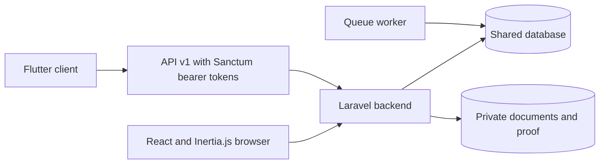
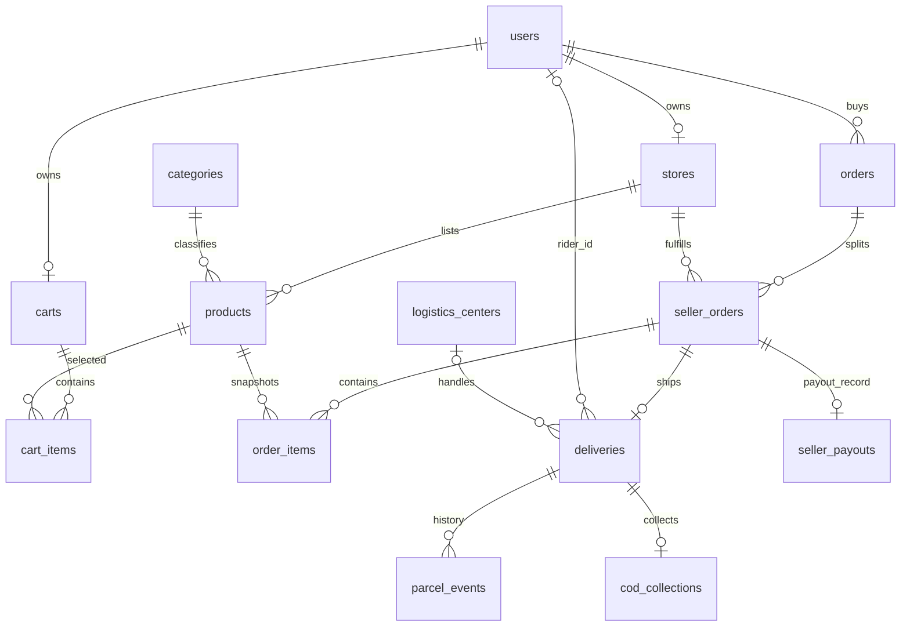

# Architecture

**System structure, technology, access boundaries and database.**

[Home](../README.md) · [Documentation](README.md) · [Website](https://lubosmart.app)

## Overview

LubosMart is a Laravel modular monolith. One backend owns accounts, commerce, Logistics, administration and shared data. React/Inertia.js provides the website; a separate Flutter client calls the versioned API. Mobile UI work is paused pending new Figma designs; its source remains an integration reference.

[System map](#system) · [Technology](#technology) · [Backend](#backend) · [Database](#database)

## System and repository map

Web sessions and API bearer tokens have separate authentication boundaries. [routes/api.php](../web/routes/api.php) and [routes/mobile.php](../web/routes/mobile.php) define the versioned API; some endpoints reuse shared web controllers and actions. See the [API guide](api/GUIDE.md) for integration and snapshot limitations.

| Location                                       | Responsibility                                                               |
| ---------------------------------------------- | ---------------------------------------------------------------------------- |
| `web/app/`                                     | Controllers, requests, models, policies, actions, services and notifications |
| `web/routes/`, `web/bootstrap/`, `web/config/` | Routes, middleware registration and configuration                            |
| `web/resources/js/`                            | React entry points, hooks, types and utilities                               |
| `web/resources/views/`                         | React pages, components and layouts, plus Blade/mail templates               |
| `web/resources/css/`, `web/resources/data/`    | Styles and reference data                                                    |
| `web/database/`                                | Migrations, factories, seeders and demonstration assets                      |
| `web/public/`, `web/storage/`                  | Web document root, runtime files and private uploads                         |
| `web/tests/`                                   | Laravel tests and browser/API harnesses                                      |
| `web/scripts/`, `scripts/`, `mobile/scripts/`  | Backend utilities, local launcher and Android helpers                        |
| `mobile/`                                      | Flutter source, assets, native projects and tests                            |
| `.github/workflows/`, `.agents/`               | Automation, repository instructions and task skills                          |

Run Laravel/npm/Docker commands from `web/` and Flutter commands from `mobile/`. Keep development output under the ignored root `.tools/development-artifacts/`; preserve databases, application keys and uploads. See [Setup](SETUP.md) and the [frontend source map](FRONTEND.md#code-map).

## Technology stack

| Layer           | Stack                                                                 |
| --------------- | --------------------------------------------------------------------- |
| Website         | React 19, TypeScript, Inertia.js 2; Blade HTML shell                  |
| Interface       | Tailwind CSS 4, Radix UI, Headless UI, Lucide                         |
| Backend         | Laravel 12, PHP 8.2+, Eloquent, Socialite, Ziggy                      |
| API             | Versioned JSON endpoints and Laravel Sanctum device tokens            |
| Data            | MySQL 8.4 in Compose; SQLite defaults for local development and tests |
| Background work | Laravel queues; database-backed queue, session and cache defaults     |
| Build           | Vite 6, Node.js 22, npm                                               |
| Mobile          | Flutter/Dart, Material 3; provisional UI retained as reference        |
| Deployment      | Docker Compose, Apache, Caddy                                         |
| Verification    | Pest, Pint, ESLint, TypeScript, Prettier, GitHub Actions              |

Docker builds with PHP 8.3; CI uses PHP 8.4. No Redis, SSR or scheduler service is defined in Compose. Azure VM hosting and Cloudflare DNS are documented operating assumptions; live settings are unverified.

Sources: [Composer](../web/composer.json), [npm](../web/package.json), [Dockerfile](../web/Dockerfile), [Compose](../web/docker-compose.yml), [Caddy](../web/Caddyfile), [CI](../.github/workflows/).

## Backend and access rules

| Location inside `web/`                                     | Responsibility                                                        |
| ---------------------------------------------------------- | --------------------------------------------------------------------- |
| `routes/web.php`, `routes/auth.php`, `routes/settings.php` | Website, authentication and settings endpoints                        |
| `routes/account.php`                                       | Same-origin session/CSRF account API                                  |
| `app/Http/Controllers/`, `app/Http/Requests/`              | Responses, validation and request authorization                       |
| `app/Models/`, `app/Policies/`                             | Data relationships and access checks                                  |
| `app/Actions/Checkout/CreateOrderFromCart.php`             | Transactional checkout shared by clients                              |
| `app/Services/`                                            | Shipping, locations, email security, finance and workspace operations |
| `app/Notifications/`, `routes/console.php`                 | Notifications and scheduled cleanup                                   |

### Accounts and permissions

Stored roles are `buyer`, `seller`, `rider`, `logistics` and `admin`. Admin accounts are privately provisioned with `php artisan lubosmart:create-admin`.

New complete Buyer, Seller and Logistics registrations require Admin review after email verification. Riders submit their full application during signup and await their affiliated Logistics company's review. Verification alone does not grant operational access. Legacy accounts and company invitations retain their applicable lifecycle. See [Workspaces](WORKSPACES.md) for role requirements.

[User::canOperate()](../web/app/Models/User.php) requires approved status and verified email; Riders also need an operational affiliated center. Rider capabilities further distinguish pickup and delivery work. Middleware, policies and ownership checks enforce these boundaries on every supported operation. Suspension/deactivation blocks operational access, including existing credentials.

Google login does not silently create or link unknown accounts. Enrollment still collects role requirements and consent. Web enrollment collects a password; native provider enrollment prohibits password fields and verifies the provider identity server-side. See [registration coverage](standards/REGISTRATION_REQUIREMENTS.md#google-registration).

### Security and business rules

- Passwords are hashed. Sensitive bank fields are encrypted and hidden from ordinary serialization.
- Registration uses six-digit emailed codes; the old verification-link endpoint returns 410. Password recovery uses a separate security-code flow.
- Registration documents and delivery proofs remain private. Downloads recheck authorization; registration document URLs also expire.
- Checkout locks stock, uses server prices, snapshots addresses/shipping/commission and supports a Buyer-scoped UUID retry key.
- Shipping remains cash. Vouchers reduce merchandise before commission and optional coin payment. Default commission is 10% of net merchandise, excluding shipping. Delivery completion and Seller settlement are separate events.
- Security mail is synchronous; operational decision/status mail queues after commit. Daily cleanup requires an external scheduler.

Use [Workflows](WORKFLOWS.md) for custody and financial rules and [Deployment](DEPLOYMENT.md) for operational checks. Source inspection does not certify live delivery, physical devices or MySQL concurrency.

## Database and data rules

Migrations define the schema; Eloquent and Query Builder access it. Local SQLite tests do not establish production MySQL locking behavior.

### Main tables

| Area                   | Tables and relationships                                                                                                               |
| ---------------------- | -------------------------------------------------------------------------------------------------------------------------------------- |
| Accounts               | `users`, profiles, registration applications/drafts/documents, approval snapshots and change requests                                  |
| Catalog                | Seller-owned `stores`, hierarchical `categories`, `products`, `product_variants`, `product_reviews`, `store_vouchers`                  |
| Shopping               | Buyer-owned `carts`, `cart_items` and `addresses`                                                                                      |
| Orders                 | `orders` split into store-owned `seller_orders`; `order_items` retain commercial snapshots                                             |
| Delivery               | `deliveries`, `parcel_events` and `parcel_assignments` retain status, checkpoints and assignment history                               |
| Logistics              | `logistics_centers`, `service_areas`, `shipping_rates`, `logistics_center_user`, `rider_service_area`                                  |
| Cash and settlement    | `cod_collections`, `cod_receipt_entries`, `logistics_remittances`, `seller_payouts`; legacy `seller_settlements` remains in the schema |
| Rider compensation     | `rider_payments`, `weekly_rider_payments`; Logistics-owned records, separate from COD                                                  |
| Wallet                 | `buyer_wallets`, `wallet_transactions`, `coin_allocations`                                                                             |
| Returns and recovery   | `parcel_returns`, `return_items`, `return_events`, `return_tasks`, `return_task_proofs`, funding entries and historical refund offers  |
| Administration/support | Audit, moderation, content, commerce settings, notifications, order messages and support conversations                                 |
| Infrastructure         | Sessions, security challenges, jobs, cache and locks                                                                                   |

The October 18 migration renamed `sorting_centers`, `sorting_center_user` and their center-ID columns to Logistics names, and converted the old `courier`/`sorting_center` roles. Existing names such as `rider_profiles` and `deliveries.rider_id` remain; `rider_id` is a current-assignment compatibility field alongside distinct pickup/delivery assignments.

### Core relationships

This is the core order/delivery model, not a complete schema diagram. Secondary actor, wallet and return relationships are omitted. Business tables generally use bigint IDs and foreign keys; `commerce_settings` uses a singleton tinyint key. Composite uniqueness protects cart/product pairs, store splits and memberships. Audit subjects and support read-message IDs are application-managed references.

### Transactions and maintenance

Checkout creates orders, deducts stock and clears the cart atomically. It preserves commercial snapshots and rejects duplicate Buyer checkout keys. Supported cancellation restores stock and coin debits once. Returns, financial adjustments and physical custody use separate records; see the [finance contract](WORKFLOWS.md#finance).

The category seeder supplies 14 departments and 83 subcategories. Follow [local setup](SETUP.md#web) for migrations and taxonomy preparation. Several migrations are forward-only; use the [backup and release runbook](DEPLOYMENT.md#deployment) before authorized production changes. Generic demo seeding is unsuitable for production.

Sources: [migrations](../web/database/migrations/), [models](../web/app/Models/), [database configuration](../web/config/database.php), [checkout action](../web/app/Actions/Checkout/CreateOrderFromCart.php).

[Documentation](README.md)
