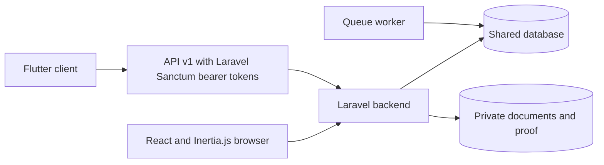
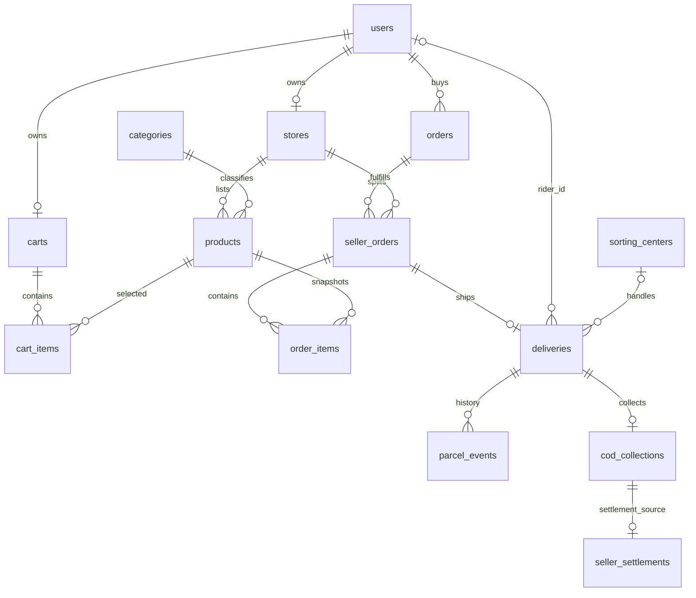

<div align="center">

# Architecture

**The shared Laravel platform, technology stack, backend and database.**

[Home](../README.md) · [Documentation](README.md) · [Website](https://lubosmart.app)

</div>

---

## Overview

This guide explains how the implemented website and native client share the Laravel backend. It brings the system map, technology choices, access rules and data model together for developers maintaining the platform.

**In this guide:** [System and repository map](#system) · [Technology stack](#technology) · [Backend and access rules](#backend) · [Database and data rules](#database)

<a id="system"></a>

## System and repository map

<a id="system-how-it-works"></a>

### How it works

LubosMart is a Laravel modular monolith: one backend owns account, commerce, Logistics and administration rules and database data. React/Inertia.js provides the integrated web client. Flutter is a separate native client calling the implemented versioned API.

<a id="system-architecture"></a>

### Architecture



The API is implemented in [routes/api.php](../web/routes/api.php) and [routes/mobile.php](../web/routes/mobile.php), with controllers under `web/app/Http/Controllers/Api/V1`. Web sessions and API bearer tokens have separate access boundaries.

<a id="system-repository-map"></a>

### Repository map

| Location                                         | Purpose                                                                                                                |
| ------------------------------------------------ | ---------------------------------------------------------------------------------------------------------------------- |
| `web/app/`                                       | Controllers, models, policies, requests, services and shared actions                                                   |
| `web/routes/`                                    | Web/auth/settings routes and versioned API routes                                                                      |
| `web/resources/js/`                              | React entry points, hooks, types and utilities                                                                         |
| `web/resources/views/`                           | Inertia.js React pages, components and layouts, plus Blade/mail templates; frontend aliases intentionally resolve here |
| `web/resources/css/`, `web/resources/data/`      | Styles and reference data                                                                                              |
| `web/database/`, `web/config/`, `web/bootstrap/` | Schema/factories/seeders, configuration and bootstrapping                                                              |
| `web/public/`, `web/storage/`                    | Web document root, runtime files and private uploads                                                                   |
| `mobile/`                                        | Flutter source, assets, Android/iOS projects and tests                                                                 |
| `web/tests/`                                     | Laravel tests, fixtures and Node browser/API harnesses                                                                 |
| `web/scripts/`, `.github/workflows/`             | Development utilities and automation                                                                                   |
| `documentation/`                                 | Product guides, standards and API contracts                                                                            |

Dependencies, SDKs, build outputs and caches are local artifacts. Databases and uploads need separate backups; they are not disposable source build output.

<a id="system-detailed-references"></a>

### Detailed references

- [Technology stack](ARCHITECTURE.md#technology)
- [Frontend architecture](FRONTEND.md#interface) and [source map](FRONTEND.md#code-map)
- [Backend and account boundaries](ARCHITECTURE.md#backend)
- [Database guide](ARCHITECTURE.md#database)
- [API coverage and contract links](api/GUIDE.md)
- [Deployment topology and backups](DEPLOYMENT.md#deployment)

The OpenAPI and Postman files are older snapshots. Later finance/return additions are described alongside them in the API guide; this cleanup does not regenerate contracts.

---

<a id="technology"></a>

## Technology stack

<a id="technology-how-it-works"></a>

### How it works

LubosMart is a Laravel modular monolith: one backend handles commerce, accounts, Logistics and administration.

<a id="technology-technology"></a>

### Technology

| Layer           | Technology                                     | Purpose                                                                            |
| --------------- | ---------------------------------------------- | ---------------------------------------------------------------------------------- |
| Front End       | React 19, TypeScript, Inertia.js 2, Blade      | Pages, forms, navigation and server-provided data                                  |
| Mobile          | Flutter / Dart, Material 3                     | Separate Buyer, Seller and Rider client in mobile; native build acceptance pending |
| UI              | Tailwind CSS 4, Radix UI, Headless UI, Lucide  | Styling, accessible components and icons                                           |
| Build           | Vite 6, Node.js 22, npm                        | Development assets and production bundles                                          |
| Backend         | Laravel 12, PHP, Apache, Socialite, Ziggy      | Business logic, authentication, Google sign-in and named routes                    |
| Database        | MySQL 8.4 in Docker Compose, Eloquent          | Relational storage and queries                                                     |
| Background work | Laravel queue worker; database-driver defaults | Notifications, cache and sessions                                                  |
| Deployment      | Docker Compose, Caddy                          | Containers, reverse proxy and HTTPS                                                |
| Testing         | Pest, Pint, ESLint, Prettier, GitHub Actions   | Tests, formatting and builds                                                       |

Composer requires PHP 8.2+. Docker uses PHP 8.3; CI uses PHP 8.4. The reviewed Composer lock resolves Laravel 12.69.3. `.env.example` defaults to SQLite; tests use in-memory SQLite.

Azure Ubuntu VM hosting and Cloudflare DNS are described in the repository runbook. Their live settings are unverified. No Redis service or external database pool is configured.

**Implemented locally, November 5, 2026:** core Laravel JSON API under `/api/v1`, with Laravel Sanctum device tokens and API Resources, alongside the existing website. See [API coverage, OpenAPI and mobile setup](api/GUIDE.md) for implemented endpoints and remaining parity.

Sources: `composer.json`, `composer.lock`, `package.json`, `Dockerfile`, `docker-compose.yml`, `Caddyfile`, `.github/workflows/`.

---

<a id="backend"></a>

## Backend and access rules

<a id="backend-how-it-works"></a>

### How it works

Laravel handles authentication, approvals, products, checkout, delivery operations and administration. Existing routes return Inertia.js pages, redirects, downloads and selected JSON responses.

November 5, 2026 update: `routes/api.php` adds stateless mobile API v1 routing alongside the website. See [the API guide](api/GUIDE.md) for device-token lifecycle, safe Resources, shared checkout/custody operations, tests and remaining parity. `routes/account.php` retains its existing session-based account endpoints.

<a id="backend-code-organization"></a>

### Code organization

| Location                                                   | Responsibility                                                |
| ---------------------------------------------------------- | ------------------------------------------------------------- |
| `routes/web.php`, `routes/auth.php`, `routes/settings.php` | Web endpoints                                                 |
| `bootstrap/app.php`                                        | Routing and middleware                                        |
| `app/Http/Controllers/`                                    | Requests and responses; some business operations              |
| `app/Http/Requests/`                                       | Form validation and request authorization                     |
| `app/Models/`                                              | Relationships, casts and queries                              |
| `app/Policies/`                                            | Account, application and support permissions                  |
| `app/Actions/Checkout/CreateOrderFromCart.php`             | Transactional checkout                                        |
| `app/Services/`                                            | Shipping quotes, locations, email security and workspace data |
| `app/Notifications/`, `routes/console.php`                 | Notifications and scheduled cleanup                           |

<a id="backend-accounts-and-access"></a>

### Accounts and access

Current public role identifiers are `buyer`, `seller`, `rider` and `logistics`; older records use courier/sorting-center terminology. Admin accounts are provisioned with `php artisan lubosmart:create-admin`.

Rider signup collects its application in the combined registration form; after verification, a complete submission waits for Logistics review. See the [Rider guide](WORKSPACES.md#rider). Current Buyer password signup activates after email verification. Complete Seller/Logistics registrations become pending after verification for Admin review. Legacy/Google onboarding can require completing an application first. Rejected applicants can correct and resubmit. Suspension/deactivation blocks existing sessions as well as new access.

| Role            | Reviewer                                                                                     | Required documents             |
| --------------- | -------------------------------------------------------------------------------------------- | ------------------------------ |
| Buyer           | Admin for review-required applications; current password signup activates after verification | ID                             |
| Seller          | Admin                                                                                        | ID and business permit         |
| Courier / Rider | Selected Logistics company / sorting center                                                  | ID, driver's license and OR/CR |
| Sorting Center  | Admin                                                                                        | ID and business/DTI permit     |

`User::canOperate()` checks approval/verification and courier center eligibility. Middleware, Policies/Gates and ownership checks protect operations. An inactive center or unapproved center operator blocks affiliated couriers.

Google signup requires a verified provider email and still follows application approval for the selected role. Google login does not create unknown accounts. Linking preserves existing roles and approval decisions. Email/password signup requires Terms and Privacy Policy acceptance; application submission also requires consent to review the submitted details and documents.

<a id="backend-security-and-business-rules"></a>

### Security and business rules

- Passwords are hashed; bank fields are encrypted and hidden from ordinary serialization.
- Registration verification uses emailed six-digit codes; the old verification-link endpoint returns 410. Recovery codes are a separate flow. See `EmailVerificationLinks`, `RegistrationEmailCodes` and `VerifyEmailController` for the current handlers.
- Registration documents and delivery proofs are private. Downloads recheck permission; registration links also have a short-lived signature.
- Checkout locks inventory, uses server prices, snapshots address/shipping/commission data and supports a Buyer-scoped UUID retry key.
- Shipping remains cash; merchandise can also use opt-in Lubos Coins as described in the [current finance contract](WORKFLOWS.md#finance). The default commission is 10% of item subtotal, excluding shipping. Delivery completion records commission; this is not proof of a Seller payout.
- Security mail sends synchronously. Decision/status mail queues after commit. Daily cleanup requires the scheduler to run.

The implemented API and website share actions/services where available. Web and API controllers must share business rules. See [API](api/GUIDE.md) and [setup](SETUP.md#guide).

Checks: `php artisan test`, `php vendor/bin/pint --test`. Tests exist under `tests/`; production locking behavior also needs MySQL checks.

---

<a id="database"></a>

## Database and data rules

<a id="database-how-it-works"></a>

### How it works

Docker Compose specifies MySQL 8.4. Laravel uses Eloquent and Query Builder; migrations define the schema. `.env.example` and automated tests use SQLite, so they do not prove production MySQL concurrency behavior.

<a id="database-main-tables"></a>

### Main tables

| Area           | Tables and relationships                                                                                                     |
| -------------- | ---------------------------------------------------------------------------------------------------------------------------- |
| Accounts       | `users`; one profile, Rider profile and registration application per user; application drafts/documents                      |
| Catalog        | One `stores` record per Seller; `categories` with parent/child hierarchy; `products` reference store/category and hold stock |
| Shopping       | One `carts` record per Buyer; `cart_items` link products/quantities; user-owned `addresses`                                  |
| Orders         | `orders` reference buyer/address; `seller_orders` split by store; `order_items` snapshot product names/prices                |
| Delivery       | One `deliveries` record per Seller order; optional Rider, center and area; `parcel_events` record history                    |
| Centers        | `sorting_centers`, `service_areas`, `shipping_rates`; `sorting_center_user` and `rider_service_area` memberships             |
| COD            | One `cod_collections` record per delivery; `seller_settlements` provides settlement storage, not a complete payout workflow  |
| Administration | `audit_events`, `product_moderations`, `platform_contents`, `commerce_settings`                                              |
| Support        | `order_messages`, `support_cases`, participants, messages and read cursors                                                   |
| Infrastructure | Sessions, verification/security challenges, jobs, cache and locks                                                            |

Business tables generally use bigint `id` primary keys and declared foreign keys. `commerce_settings` uses a singleton tinyint key. Composite uniqueness protects cart/product pairs, order/store splits and memberships. Audit subjects and support read-message IDs are application-managed references, not declared foreign keys.

<a id="database-core-relationships"></a>

### Core relationships



This diagram shows the main migration-defined relationships; secondary reviewer/actor links are omitted. Foreign keys allow empty child collections; checkout creates the required order items/splits transactionally.

<a id="database-data-rules-and-maintenance"></a>

### Data rules and maintenance

Checkout creates orders, deducts stock and clears the cart in one transaction. It preserves prices, shipping addresses, quotes and commission rates. Unique buyer/checkout keys prevent retry duplication. Cancellation is allowed while all order parts remain pending and restores stock.

The role is stored on `users`; there is no separate role pivot. Current roles are `buyer`, `seller`, `courier`, `sorting_center`, `admin`. Historical names such as `rider_profiles` and `deliveries.rider_id` remain in the schema.

```powershell
php artisan migrate
php artisan db:seed --class=MarketplaceCategorySeeder
```

> [!WARNING]
> The taxonomy seeder supplies 14 departments and 83 subcategories. Avoid the generic demo seeder in production. Several account migrations are forward-only. Back up the database and private uploads before production changes; see [Deployment](DEPLOYMENT.md#deployment).

Source: `database/migrations/`, `database/seeders/`, `app/Models/`, `config/database.php`. Database cache/session/queue defaults exist; no Redis service or external connection pool is configured.

---

<div align="center">

**LubosMart** · Architecture · [Documentation](README.md)

</div>
