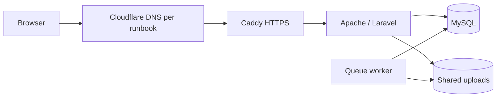

<div align="center">

# Deployment and operations

**Production services, release procedures, backups and email acceptance.**

[Home](../README.md) · [Documentation](README.md) · [Website](https://lubosmart.app)

</div>

---

## Overview

This guide covers the documented deployment topology, authorized release procedures and recovery requirements. It also includes transactional email checks and controlled inbox acceptance for operators maintaining an installation.

**In this guide:** [Deployment and backups](#deployment) · [Transactional email verification](#mail)

<a id="deployment"></a>

## Deployment and backups

<a id="deployment-how-it-works"></a>

### How it works

Repository layout update: deployment files and the environment now live in
`web/`. Run the commands in this guide from `web/` and use it as the Docker build
context. Compose explicitly retains the `lubosmart-app` project name to preserve
the prior default volume names. Existing deployments using a custom project name
must continue supplying that name. No deployment was performed for this move.

The repository describes production on an Azure Ubuntu VM with Docker Compose and Cloudflare DNS. Live VM/DNS settings, deployed versions, Cloudflare proxy/WAF/cache features and backup execution are unverified. Deployment is manual; GitHub Actions builds/tests do not deploy the VM.

<a id="deployment-local-setup"></a>

### Local setup

Use the canonical [Laravel/web setup](SETUP.md#web), [Flutter setup](SETUP.md#flutter) and [environment reference](SETUP.md#environment). Commands below concern separately authorized deployment work, not this documentation cleanup.

<a id="deployment-email-and-google-configuration"></a>

<a id="deployment-configuration"></a>

### Configuration

Set `MAIL_MAILER=smtp` and `MAIL_SECURITY_MAILER=smtp` with your provider's credentials and authorized sender. For Gmail, the existing guide uses `MAIL_HOST=smtp.gmail.com`, `MAIL_PORT=587`, `MAIL_SCHEME=smtp`, `MAIL_ENCRYPTION=tls` and an App Password. Keep the username, sender and reply-to consistent with the authorized mailbox. Never use a log mailer for real security codes.

```powershell
php artisan config:clear
php artisan lubosmart:mail-status --check-connection
```

A successful connection does not prove inbox delivery; test an actual registration. Security emails send synchronously; approval/status emails require the queue. `APP_URL` must be reachable from the device opening verification links.

Google sign-in uses private `GOOGLE_CLIENT_ID`, `GOOGLE_CLIENT_SECRET` and an exact `GOOGLE_REDIRECT_URI`: locally `http://localhost:8000/auth/google/callback`, production `https://lubosmart.app/auth/google/callback`. Use the same hostname throughout login and register the callback in the provider.

<a id="deployment-production-services"></a>

### Production services

| Service | Role                                                                    | Storage                                |
| ------- | ----------------------------------------------------------------------- | -------------------------------------- |
| `app`   | PHP 8.3/Apache Laravel image; Node 22 builds assets in an earlier stage | `app-storage`                          |
| `queue` | Shared image, operational notification worker                           | Shared `app-storage` and database jobs |
| `db`    | MySQL 8.4, internal network, ping health check                          | `mysql-data`                           |
| `caddy` | Public HTTPS, compression and reverse proxy to `app:80`                 | `caddy-data`, `caddy-config`           |



Only Caddy publishes ports. Caddy manages origin certificates; Apache runs PHP behind it. MySQL and uploads survive container recreation through named volumes. No Nginx, Redis, SSR or scheduler service is defined in Compose.

<a id="deployment-release-steps"></a>

<a id="deployment-deployment-steps"></a>

### Deployment steps

> [!IMPORTANT]
> Execute only with explicit deployment authorization for the reviewed release. A documentation change or Git push/merge alone is not that authorization.

Review/merge to `main`, connect through your established SSH access, and retrieve the approved release. Preserve production credentials and `APP_KEY`. Verify database/private-upload backups stored outside Docker volumes and copied off the VM before migrations.

Run in the VM checkout; stop if any command fails:

```bash
git status --short
git switch main
git pull --ff-only origin main
docker compose config --quiet
docker compose build app
docker compose exec app php artisan down --retry=60
docker compose stop queue
docker compose up -d --no-deps --force-recreate app
docker compose exec app php artisan optimize:clear
docker compose exec app php artisan migrate --force
docker compose exec app php artisan optimize
docker compose exec app php artisan lubosmart:mail-status --check-connection
docker compose up -d --no-deps --force-recreate queue
docker compose exec app php artisan up
docker compose ps
curl -I https://lubosmart.app/up
```

Production requires `APP_ENV=production`, `APP_DEBUG=false`, HTTPS `APP_URL`, secure cookies and MySQL `DB_HOST=db`. Keep `.env` private. Do not expose database port 3306. Arrange `schedule:run` every minute for the existing daily cleanup; live scheduling is unverified.

> [!WARNING]
> Check queue/logs, real email, login and role journeys after release. Keep a compatible previous image/revision for recovery; several account migrations cannot be rolled back. Never run `migrate:fresh`, demo/test-account seeders or `docker compose down -v` in production. Restore tested database/uploads together when recovery requires it.

Sources: `Dockerfile`, `docker-compose.yml`, `Caddyfile`, `.github/workflows/`, `routes/console.php`.

---

<a id="mail"></a>

## Transactional email verification

<a id="mail-how-it-works"></a>

### How it works

Google-linked accounts can request Forgot password or set a LubosMart password in
Settings > Password after verifying an email code. Both Google sign-in and direct
email/password sign-in remain available. Invitation-only accounts still need their
activation flow. Codes expire after ten minutes, allow five verification attempts
and are limited to three requests per email per hour.

<a id="mail-azure-docker-checks"></a>

<a id="mail-commands"></a>

### Commands

Run these read-only checks on the VM after an authorized deployment:

```bash
docker exec lubosmart-app-app-1 php artisan lubosmart:mail-status --check-connection
docker exec lubosmart-app-app-1 php artisan queue:failed
docker logs --tail 50 lubosmart-app-queue-1
```

The mail-status command checks the security mailer only. Verify privately that both
`MAIL_MAILER` and `MAIL_SECURITY_MAILER` select the intended SMTP mailer in the
deployed configuration. Other notifications use the default mailer. Both app and
queue containers need correct mail configuration. Delivery updates, listing reviews
and account status notices need a running queue worker. Do not post credentials,
environment dumps, codes, tokens or unredacted recipient logs.

<a id="mail-inbox-acceptance"></a>

### Inbox acceptance

SMTP authentication and automated tests do not prove live inbox delivery. Use
controlled test accounts/inboxes and existing workflows to verify:

1. Registration and email re-verification codes, including resend.
2. Forgot password for Google-linked and direct-sign-in accounts.
3. Settings password setup/change and profile confirmation codes.
4. Application approval and rejection notices.
5. Account suspension, deactivation and reactivation notices.
6. Rider invitation/activation messages.
7. Delivery updates and Seller listing review notices through the queue.

Check recipient, Inbox/Spam, sender, subject, HTML/plain text, expiry and links.
For Google accounts, finish the code/reset flow and confirm both sign-in methods
on the same account. Confirm consumed codes/tokens cannot be reused. Do not change
real account statuses or orders merely to test mail.

Public Forgot password intentionally returns the same message for unknown accounts,
throttled requests and sending failures. Inspect fresh application logs when a
controlled test fails; never infer inbox delivery from that message.

<a id="mail-automated-coverage-and-ui-review"></a>

### Automated coverage and UI review

`tests/Feature/Notifications/TransactionalMailTest.php` exercises all seven
notification classes using Laravel's in-memory mail transport, verifies headers
and HTML/plain text, and completes password reset using the rendered email code
for both account types. Auth/settings tests cover verification and reset security.
These tests send no external email and do not certify production delivery.

Final local regression on 2026-11-09: 991 passed, 3 skipped (6,921 assertions)
across Auth, Settings, Notifications, Account, API, Admin registration/management,
marketplace flow and Logistics approval tests. PHP formatting passed. An initial
delivery-proof storage assertion failed while two test processes overlapped; the
isolated test and the final regression without concurrent Laravel tests passed.

2026-11-09 UI review: password settings now exposes the existing form for Google
accounts, with copy explaining both sign-in methods. Current password is omitted
only for initial setup. Branding, shared controls and email confirmation remain.
ESLint, TypeScript, Prettier and production build passed. Browser visual, keyboard,
zoom and screen-reader acceptance were not performed; WCAG compliance is unverified.

---

<div align="center">

**LubosMart** · Deployment and operations · [Documentation](README.md)

</div>
