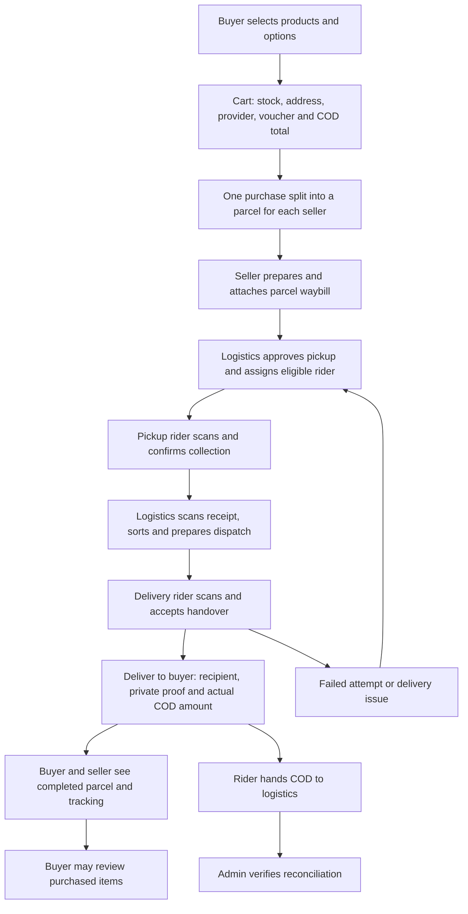

# Seller and buyer workflows and role connections

Update, 2026-10-26: manual seller payouts, Logistics-owned Rider payments, seller cost/profit records and controlled whole-parcel returns/refunds are now implemented. See [finance and returns](FINANCE_AND_RETURNS.md) and the [complete feature checklist](SYSTEM_FEATURE_CHECKLIST.md) for current behavior and verification. Earlier dated checks below retain their original scope.

Implementation: 2026-10-25, Asia/Manila. This describes local source and verification, not a deployment certification.

## Seller and buyer feature scope

| Feature | Behavior |
| --- | --- |
| Seller workspace | Store-only queues, task counts, inventory, preparation, waybills, conversations and completed proceeds |
| Buyer workspace | Own purchase counts, direct purchase links, wishlist, addresses, delivery issues and support |
| Search and tracking | Buyer searches order/parcel IDs, tracking, product or store; both roles filter queues; order lists refresh every 30 seconds while mounted |
| Physical progress | Pickup, center receipt, sorting, dispatch acceptance and delivery timestamps come from recorded delivery fields; unrecorded events remain explicit |
| Size/color variants | Seller defines up to 50 named combinations; each has its own stock and active/retired state. All combinations share the product price and packed weight. Two options of one product remain separate cart/order lines |
| Variant inventory | Product stock is the sum of option stocks, including retired stock. Buyers see available option stock. Checkout checks active option stock, decrements it and aggregate stock atomically, and snapshots the option name |
| Vouchers | Seller creates a unique, fixed peso code, minimum store subtotal, expiry and total use limit. Codes can be paused. One code per checkout and one non-cancelled use per buyer |
| Discount calculation | Only the issuing store's items are discounted, capped at their subtotal. Shipping is unchanged. The buyer applies the code and reviews the discount before checkout; the server recalculates it and rejects changed discounts |
| Financial snapshots | Seller-order subtotal is product sales after voucher discount; item prices retain their original agreed values. Voucher code and discount are stored separately. Commission applies to that net product subtotal, excluding shipping |
| Cancellation | Buyer cancellation remains available only before any seller begins preparation. It restores product and option stocks once. A cancelled order releases its voucher use |
| Ratings | Only the buyer of an item in a completed, delivered parcel can submit/edit its 1–5 star review. One review per order item; separate purchases/options can have separate reviews |
| Review moderation | Public product pages and catalogue averages include visible reviews only. Authorized compliance admins can hide/restore a review with a reason and audit entry. Buyer edits cannot unhide a moderated review; sellers cannot moderate ratings |

Entry points: seller `/inventory`, `/seller/vouchers`, `/orders`, `/reports`; buyer `/dashboard/buyer`, `/shop`, `/products/{product}`, `/cart`, `/orders`; admin `/admin/product-reviews`, also linked from Seller Compliance.

Vouchers are seller-funded discounts, not prepaid balances, gift cards or platform subsidies. Enabling/disabling a code does not change historical orders. Variants use combined labels such as “Small / Purple”; different option prices, weights and photos are not part of this implementation. Reviews do not trigger refunds.

## How the roles connect

| Role | Core responsibility | What connects it to the other roles |
| --- | --- | --- |
| Buyer | Choose items, address and shipping; confirm COD; receive products and report issues | Purchase splits by seller. Tracking follows each parcel independently. Seller messages stay attached to that parcel |
| Seller | Maintain compliant listings and option stock; fund its vouchers; pack correct items and print the label | Checkout reserves stock. Marking ready creates work for logistics; it does not prove physical pickup |
| Logistics | Control own-company pickup, receipt, sorting, dispatch, rider coverage and cash receipt | Receives seller-ready parcels and assigns authorized riders. Center receipt and rider dispatch acceptance establish separate handovers |
| Rider | Collect assigned parcels, accept dispatch, deliver with evidence and record cash actually collected | Scans the parcel waybill, not a product barcode or the buyer's whole purchase. Pickup and delivery riders may differ |
| Admin | Approvals, compliance, disputes, review moderation, commission oversight and reconciliation | Oversees the process while preserving company/store/assignment boundaries. Logistics approves affiliated riders |

Orders, physical custody and cash have separate meanings. Printing a label does not move a parcel. Assigning a rider does not prove collection. Delivery completion does not prove that logistics received the cash or that a seller was paid.

### Two stores in one checkout

A buyer purchasing from two stores receives one purchase with two seller parcels, two tracking references and separately calculated shipping. Completing one parcel does not complete the other. The rider collects only that parcel's COD amount. A voucher applies only to its issuing store.

### Example with a voucher

For one parcel: PHP 1,000 original items − PHP 100 seller voucher = PHP 900 net product sales. Add PHP 80 shipping: the rider collects PHP 980. At a snapshotted 10% commission, commission is PHP 90 and seller proceeds are PHP 810. Shipping is separate; it is not automatically rider earnings. Displayed proceeds are not a payout receipt.

### When connectivity fails

Operations require server confirmation. A scan selects a parcel; the rider/logistics user still confirms the permitted action. An interrupted connection must not be treated as a successful pickup, delivery or cash handover. Camera/manual-input fallbacks preserve the same authorization and stage checks. There is no verified offline custody synchronization feature.

## Verification and local database

The new migration adds option stock, separate option cart/order keys, voucher snapshots and product reviews while preserving existing base-product records. It was applied successfully to local XAMPP MySQL after a private SQL backup under `storage/app/private/backups/`. No deployment, commit or push is part of this task.

Focused feature tests cover buyer isolation, filters, variants, stock restoration, voucher minimums/expiry/limits/idempotency, multi-store discounts, delivered-purchase reviews and moderation. The existing five-role marketplace journey additionally runs with a variant and voucher, checking discounted COD through logistics receipt and admin reconciliation.

The disposable SQLite browser harness covers seller saves, preparation and labels, buyer search, reviews, buying two options together, first-address selection, voucher confirmation and COD checkout. It checks 320/768/1280px layouts and light/dark themes. Artifacts are under `storage/app/seller-workspace-ui-check/`.

The full regression run identified two stale dashboard assertions (corrected for dedicated buyer/seller pages) and two historical Logistics settings tests that still attempt mutations through `/settings/profile`. Current Logistics company re-verification uses `/api/account/reverification` with all required documents; the old mutation endpoint deliberately refuses these writes. The existing access boundary remains intact. See [account settings](ACCOUNT_SETTINGS.md).

Final full-suite result: **1,041 passed, 3 skipped, 2 failed (7,815 assertions)**. The two remaining failures are the historical Logistics profile-edit expectations above. A new supported-API integration test verifies company re-verification blocks affiliated riders, admin approval updates the same center, and rider access resumes. TypeScript, targeted ESLint/Prettier, PHP Pint and the production build pass. Twelve browser scenarios pass, including admin review moderation; mobile cart readability was corrected after screenshot review.

Physical printer/scanner/phone tests, full screen-reader and zoom/contrast verification, and deployed acceptance remain outstanding. Automated checks do not certify WCAG compliance. SQLite tests do not independently certify concurrent MySQL load behavior.

## Remaining business extensions

Automatic bank transfers and online payments remain outside the implemented COD workflow. Manual seller settlements, Logistics-owned Rider fees/payments, seller recorded-cost profit and whole-parcel return/refund records are now supported through the owner's approved process; consult the dated finance update above. Item-by-item partial returns, automated payment-provider refunds and an audited tax/inventory-cost accounting system are not implemented.

See also [core workflow requirements](standards/CORE_WORKFLOWS_AND_SCANNING_REQUIREMENTS.md), [parcel scanning](PARCEL_SCANNING.md), [seller functions](functions/seller/README.md), [buyer functions](functions/buyer/README.md), and [UI verification log](standards/UI_UX_AUDIT.md).
