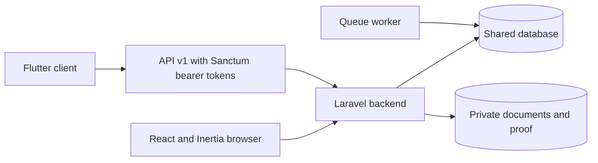

# System architecture and repository map

LubosMart is a Laravel modular monolith: one backend owns account, commerce, logistics and administration rules and database data. React/Inertia provides the integrated web client. Flutter is a separate native client calling the implemented versioned API.

The API is implemented in [routes/api.php](../../web/routes/api.php) and [routes/mobile.php](../../web/routes/mobile.php), with controllers under `web/app/Http/Controllers/Api/V1`. Web sessions and API bearer tokens have separate access boundaries.

## Repository map

| Location                                         | Purpose                                                                                                             |
| ------------------------------------------------ | ------------------------------------------------------------------------------------------------------------------- |
| `web/app/`                                       | Controllers, models, policies, requests, services and shared actions                                                |
| `web/routes/`                                    | Web/auth/settings routes and versioned API routes                                                                   |
| `web/resources/js/`                              | React entry points, hooks, types and utilities                                                                      |
| `web/resources/views/`                           | Inertia React pages, components and layouts, plus Blade/mail templates; frontend aliases intentionally resolve here |
| `web/resources/css/`, `web/resources/data/`      | Styles and reference data                                                                                           |
| `web/database/`, `web/config/`, `web/bootstrap/` | Schema/factories/seeders, configuration and bootstrapping                                                           |
| `web/public/`, `web/storage/`                    | Web document root, runtime files and private uploads                                                                |
| `mobile/`                                        | Flutter source, assets, Android/iOS projects and tests                                                              |
| `web/tests/`                                     | Laravel tests, fixtures and Node browser/API harnesses                                                              |
| `web/scripts/`, `.github/workflows/`             | Development utilities and automation                                                                                |
| `documentation/`                                 | Product guides, standards and API contracts                                                                         |

Dependencies, SDKs, build outputs and caches are local artifacts. Databases and uploads need separate backups; they are not disposable source build output.

## Detailed references

- [Technology stack](../tech-stack/README.md)
- [Frontend architecture](../front-end/README.md) and [source map](../front-end/code-map.md)
- [Backend and account boundaries](../backend/README.md)
- [Database guide](../database/README.md)
- [API coverage and contract links](../api/README.md)
- [Deployment topology and backups](../deployment/README.md)

The OpenAPI and Postman files are older snapshots. Later finance/return additions are described alongside them in the API guide; this cleanup does not regenerate contracts.

[Documentation index](../README.md)
