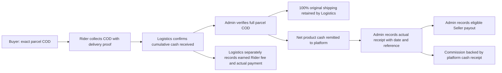

> Historical record: retained with its original findings and execution results. It is not current acceptance or deployment verification. See the [current documentation index](../../README.md).

# Finance and fulfillment implementation — November 11, 2026

This report covers local source changes. It does not certify production readiness or a deployed release. The initial findings are in [the audit matrix](FINANCIAL_FULFILLMENT_AUDIT_2026_11_11.md).

## Approved cash model

During this implementation the owner explicitly selected **Logistics retains shipping and remits product proceeds plus commission**. That resolves the audit's original onward-cash question. No separate shipping payout or full-COD-to-platform transfer is implemented.

Parcel custody continues through the existing preparation → approved pickup → Rider collection → center receipt → sorting → dispatch preparation → Rider acceptance → delivery states. Cash uses existing collected → handed_over → reconciled values. A shortage remains collected with receipt evidence, reason and retained parcel events until Logistics records the verified cumulative full receipt. Assignment, delivery, allocation, receipt, reconciliation and payout remain distinct.

## Preserved functionality

Existing checkout, route URLs, role names, shared database/backend, product and option inventory, private proof storage, custody events, vouchers, cancellation releases, seller preparation, manual seller payouts, Logistics-only Rider payments, costs/profit, support investigations and whole-parcel returns remain in place. Homepage, authentication and branding were not changed by this finance work. Pre-existing notification/UI changes were retained.

## Implemented changes

- `/logistics-settlements`: original shipping allocation, reconciled/pending amounts, shipping retained alongside confirmed product remittances, explicit new shipping refunds, and product-cash receipt history. Logistics sees its own operational companies; Admin sees all. The original parcel/provider snapshots are the allocation ledger; no duplicate allocation table or invented historical payment is generated.
- Admin records the **entire original net product subtotal**, excluding shipping, with actual receipt date, unique reference and evidence notes. Partial receipts are refused. Database uniqueness, store/parcel locks, transactions and transactional audit logging protect the record. Repeating a request cannot create another receipt. No cash transfer is initiated.
- Seller payout now requires matching reconciled COD **and** an actual matching platform product-cash receipt for the assigned provider. Store balance excludes unreconciled/unfunded parcels and parcels with unresolved returns. Original payouts/debits remain in the balance. A later unreconciled sale cannot mask old refund debt.
- `/finance` and `/api/v1/finance`: role-scoped all-time financial position, original gross/voucher/net sales, separate expected/recognized/reconciled/cash-backed commission, shipping, receipts, refunds, payout and recovery figures. Seller costs/profit and company/own Rider earned/paid/outstanding fees use existing ledgers. Admin receives no Rider wage information. Recovery balances are calculated per store before aggregation; another Seller's positive proceeds cannot hide debt.
- Shared `ParcelFinance` converts decimal snapshots to integer centavos, applies half-up commission rounding, checks COD evidence, verifies product-cash funding and calculates refund splits. Existing historical decimal columns remain unchanged. Checkout, delivery commission, reconciliation, refund and settlement use this shared boundary where changed.
- New returns start without an inferred responsible party. Admin records Seller, Logistics, Buyer or undetermined responsibility with reviewed evidence/reason, actor, timestamp, return event and audit record. Finalized returns cannot be reclassified. New Seller-funded refunds require an explicit reviewed Seller responsibility decision. Verified Logistics fault cannot silently deduct Seller proceeds.
- New refunds store explicit product and shipping components while retaining original totals, commission reversal and Seller debit. Existing full-COD refund behavior is preserved; a shipping refund is not automatically charged against Logistics entitlement or Rider wages.
- Sellers see voucher usage history with parcel, snapshotted code/discount, date and cancellation-release status. Existing single-voucher, own-store, minimum, expiry, use-limit, per-Buyer, locked redemption and cancellation logic is preserved.
- Ordinary seller order/return responses omit buyer phone, street, barangay, ZIP, address ID and buyer account ID where those fields were serialized. Mobile ordinary seller parcels omit contact/address fields. Authorized own-parcel waybill printing retains necessary recipient details; foreign waybill access remains denied. Dashboard summaries already used limited recipient/city fields. Private delivery proof and existing support evidence remain authorized routes.
- Consequential remittance, Seller payout and refund recording use the existing accessible dialog component; duplicate submission is disabled during processing. Finance navigation and Flutter Account → Finance overview expose backend-calculated amounts without client financial formulas.

## Calculations and settlement meaning

| Component | Example in PHP |
| --- | ---: |
| Gross products | 1,000.00 |
| Seller-funded voucher | 100.00 |
| Net products | 900.00 |
| Shipping retained by Logistics | 80.00 |
| Buyer COD collected / Logistics cash receipt | 980.00 |
| Platform product-cash remittance | 900.00 |
| Platform commission at snapshotted 10% | 90.00 |
| Seller proceeds | 810.00 |

Recognized commission arises on delivery; reconciled commission requires verified full Logistics cash receipt; cash-backed commission requires the separately recorded product remittance. Reversals remain separate adjustments. These overlapping measures must not be added together or treated as profit. No unverified off-platform sale creates platform revenue or receivables.

For a confirmed PHP 300 product refund, reverse commission by PHP 30 and deduct PHP 270 from Seller proceeds. For a confirmed PHP 980 full COD refund, product refund is PHP 900, commission reversal PHP 90, Seller debit PHP 810 and shipping refund PHP 80. Refund limits use the reconciled original parcel COD; voucher snapshots remain intact. An earlier payout stays historical and can create a Seller recovery balance. Existing full remaining parcel payouts are preserved; automatic partial debt offsets are not introduced.

## Permission matrix

| Capability | Admin | Seller | Logistics | Rider | Buyer |
| --- | --- | --- | --- | --- | --- |
| Financial overview | Platform, excluding Rider wages | Own store | Own companies | Own COD/fees | Existing purchase totals |
| Shipping/remittance ledger | All | Denied | Own companies, read only | Denied | Denied |
| Confirm platform product-cash receipt | Finance-authorized | Denied | Denied | Denied | Denied |
| Record Seller payout | Finance-authorized | Own history only | Denied | Denied | Denied |
| Earn/pay Rider fee | Denied | Denied | Existing own-company controls | Own history only | Denied |
| Prepare parcel / print waybill | Existing authorized oversight | Own parcels | Existing operational access | Existing assigned access | Denied |
| Mark delivered / collect COD | Cannot impersonate Rider | Denied | Cannot impersonate Rider | Assigned operational Rider | Denied |
| Receive Rider cash | Denied | Denied | Assigned company | Cannot confirm own receipt | Denied |
| Reconcile COD | Finance-authorized | Denied | Denied | Denied | Denied |
| Review return responsibility / record refund | Finance-authorized | Denied | Denied | Denied | Denied |
| Return collection / Seller receipt | Review only | Own physical receipt | Own return assignment | Assigned collection | Own request |

The application currently grants the same admin permission set to all operational Admin accounts; this change uses the existing `canAdmin('finance')` contract without inventing new roles.

## Files and migrations

New application files:

- `app/Services/ParcelFinance.php`, `app/Services/SellerBuyerPrivacy.php`
- `app/Models/LogisticsRemittance.php`
- `app/Http/Controllers/FinanceController.php`, `app/Http/Controllers/LogisticsSettlementController.php`
- `resources/views/pages/finance/overview.tsx`, `resources/views/pages/finance/logistics-settlements.tsx`

Changed application files:

- `app/Actions/Checkout/CreateOrderFromCart.php`
- `app/Http/Controllers/DeliveryController.php`, `OrderController.php`, `ParcelReturnController.php`, `SellerSettlementController.php`, `StoreVoucherController.php`
- `app/Http/Controllers/Api/V1/RoleDataController.php`, `app/Http/Resources/Api/ParcelResource.php`
- `app/Models/ParcelReturn.php`, `app/Models/SellerOrder.php`
- `routes/web.php`, `routes/api.php`
- `resources/views/pages/finance/returns.tsx`, `finance/settlements.tsx`, `seller/vouchers.tsx`, `marketplace/orders.tsx`
- `resources/views/components/shared/record-action.tsx`, `resources/views/components/navigation/app-sidebar.tsx`
- `apps/mobile/lib/features/community.dart`, `seller.dart`, `work.dart`

Validation sources: `tests/Feature/SettlementAndReturnsTest.php`, `tests/Feature/Logistics/LogisticsWorkspaceTest.php`, `tests/Fixtures/finance-browser-seed.php`, `tests/Frontend/finance-browser-check.cjs`.

New additive migrations:

1. `2026_11_11_074701_add_reviewed_responsibility_and_refund_splits_to_parcel_returns.php`: nullable reviewed responsibility and explicit refund splits; no historical backfill or automatic fault assignment.
2. `2026_11_11_075119_create_logistics_remittances_table.php`: one manual original product-cash receipt per parcel, unique reference, provider, actor, date, centavo amount and notes.

Neither migration has been applied to the configured database. Tests applied them only to disposable SQLite databases. Populated financial columns/tables refuse rollback; use a reviewed forward migration. Existing completed records require evidence-based receipt entry before new payouts; this is a deliberate hold, not authorization to fabricate historical remittances.

## Outstanding policy decisions and limitations

- Logistics-caused product refund funding, recoverable Logistics liability and its settlement/offset method remain pending. Such refunds are held rather than debiting the Seller. The reviewed responsibility and evidence are recorded, but do not themselves establish a legally enforceable receivable.
- Buyer change-of-mind eligibility/costs, return transport pricing/responsible party/collection evidence and payment mechanism remain pending. No transport invoice, COD increment or Rider deduction is invented.
- Shipping refund funding and allocation of liability remain pending. Actual existing manual refund capability and explicit shipping adjustments are retained; no automatic shipping clawback is created.
- Established contractual commission receivables and automatic Seller recovery offsets need approved policy. Expected commission and retained historical recovery balances are visible; no automatic penalties, account restrictions or invented collections arise from a support complaint.
- Existing support complaints retain parcel, reporter/participants, private evidence, investigation status, resolution and audit trail. The subsequent [fulfillment protection phase](FULFILLMENT_PROTECTION_VERIFICATION_2026_11_11.md) adds structured suspected activity categories, sensitive access audits and explicit Seller override refusal. Financial penalties and contractual receivable creation remain pending approved policy.
- Historical null commission snapshots retain the existing legacy delivery fallback to the configured rate. The overview explicitly flags missing historical rates and excludes them from expected commission until reviewed; no historical rate is guessed/backfilled by a migration.
- Mobile Seller/Buyer/Rider screens use the same backend. Logistics/Admin finance endpoints exist, but native Logistics/Admin navigation remains the application's existing website-only scope. No device/APK acceptance is claimed.
- The finance overview streams scoped rows; high-volume MySQL performance/query plans and concurrent MySQL money/stock operations still need dedicated validation. SQLite request tests establish sequential behavior and rollback, not production contention.
- Seller payouts retain the existing recording timestamp and full-parcel scope. Separate backdated Seller payment dates and partial settlement/recovery offset records were not added. Product-cash remittances have an explicit actual receipt date.
- Standard printing/scanning, real physical cash and parcel handovers, actual manual transfers, offline interruptions, screen-reader testing, full contrast assessment and 200%/400% zoom acceptance have not been physically verified. Builds/screenshots do not certify WCAG compliance.

## Manual defense demonstration

Use synthetic accounts and a disposable database. Show a PHP 1,000 product basket with a PHP 100 Seller voucher, PHP 80 shipping and 10% commission. Confirm PHP 980 parcel COD and PHP 810 Seller proceeds. Prepare, approve pickup, assign/collect, receive/sort, dispatch/accept and deliver with private proof. Show the blocked Seller attempt to mark delivery or reconcile COD, plus an unrelated store/provider access refusal.

Record a short cumulative Rider handover with its reason; demonstrate reconciliation and payout refusal. Record the verified full PHP 980 Logistics receipt and Admin reconciliation. Open Shipping allocations: PHP 80 entitlement and no inferred product remittance. Admin confirms actual PHP 900 platform receipt with reference/date/evidence; show PHP 80 retained by Logistics. Record actual PHP 810 Seller payout once; demonstrate replay refusal. Logistics separately records an agreed completed-work Rider fee and actual payment; demonstrate Admin denial of Rider payment access.

On a separate delivered parcel, request/approve/assign/collect/receive a whole-parcel return. Show damaged goods without restock. Record evidence-based Seller responsibility and actual PHP 300 product refund; verify PHP 30 reversal and PHP 270 Seller debit without changing original sale/voucher/COD records. Show Logistics responsibility holding the refund without charging the Seller. Submit suspected bypass evidence through the existing complaint workflow and show human review without automatic penalty or revenue.

## Verification

| Check | Result / evidence |
| --- | --- |
| Final isolated full Laravel suite | **1,196 passed, 3 skipped, 0 failed; 9,718 assertions**, 273.36 seconds. `storage/app/finance-validation/laravel-isolated.txt` |
| Focused final finance tests | **29 passed, 577 assertions**, including roles/company isolation, duplicate receipts, transactional audit rollback, missing reconciliation/funding holds, refund responsibility, voucher-adjusted splits, Seller privacy, per-store recovery totals and fractional-centavo eligibility. `storage/app/finance-validation/finance-focused.txt` |
| Affected Logistics + finance run | **70 passed, 1,250 assertions** before the final two finance cases were added. The legacy cash fixture now marks both parcel and delivery completed, matching the stronger reconciliation invariant. |
| Browser checks | **5 passed checks**: four finance roles and zero uncaught exceptions. Admin actual product-remittance form, subsequent payout eligibility, Seller privacy and voucher history were exercised; 320/768/1440px and dark screenshots captured. `storage/app/finance-ui-check/results.json` |
| TypeScript / targeted ESLint / Prettier | Passed for changed frontend files. |
| PHP Pint | Passed for changed PHP files and migrations. |
| Production Vite build | Passed; 2,466 modules transformed. |
| Flutter analysis | Passed with `FLUTTER_SUPPRESS_ANALYTICS=true` and `DART_SUPPRESS_ANALYTICS=true`; no issues found. Initial telemetry attempts were blocked by filesystem permissions; suppressing telemetry resolved the tool failure. |
| Physical devices, real cash/transfers, MySQL contention, deployment | **Not executed**. |

Initial full-suite execution found one inconsistent legacy cash fixture; it was corrected without weakening the new guard. A subsequent overlapping test run reported three missing-file failures in account document, Buyer registration approval and delivery-proof tests. Laravel's shared fake-storage root was being cleaned by concurrent test processes. The final full-suite run used a unique Laravel `TEST_TOKEN` with in-memory SQLite to isolate those test files and passed with zero failures. No unrelated application authorization or document/proof logic was weakened to resolve the test interference.

The suite contains **three explicitly skipped** historical browser password-visibility cases (Buyer, Seller and Logistics); this finance task does not claim those checks were executed. See [UI verification](../ui-audits/FINANCE_UI_AUDIT_2026_11_11.md) and [API additions](../../api/FINANCE_2026_11_11.md).
