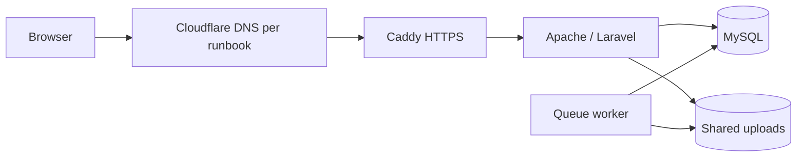

# Deployment and backups

Repository layout update: deployment files and the environment now live in
`web/`. Run the commands in this guide from `web/` and use it as the Docker build
context. Compose explicitly retains the `lubosmart-app` project name to preserve
the prior default volume names. Existing deployments using a custom project name
must continue supplying that name. No deployment was performed for this move.

The repository describes production on an Azure Ubuntu VM with Docker Compose and Cloudflare DNS. Live VM/DNS settings, deployed versions, Cloudflare proxy/WAF/cache features and backup execution are unverified. Deployment is manual; GitHub Actions builds/tests do not deploy the VM.

## Local setup

Use the canonical [Laravel/web setup](../setup/WEB.md), [Flutter setup](../setup/FLUTTER.md) and [environment reference](../setup/ENVIRONMENT.md). Commands below concern separately authorized deployment work, not this documentation cleanup.

## Email and Google configuration

Set `MAIL_MAILER=smtp` and `MAIL_SECURITY_MAILER=smtp` with your provider's credentials and authorized sender. For Gmail, the existing guide uses `MAIL_HOST=smtp.gmail.com`, `MAIL_PORT=587`, `MAIL_SCHEME=smtp`, `MAIL_ENCRYPTION=tls` and an App Password. Keep the username, sender and reply-to consistent with the authorized mailbox. Never use a log mailer for real security codes.

```powershell
php artisan config:clear
php artisan lubosmart:mail-status --check-connection
```

A successful connection does not prove inbox delivery; test an actual registration. Security emails send synchronously; approval/status emails require the queue. `APP_URL` must be reachable from the device opening verification links.

Google sign-in uses private `GOOGLE_CLIENT_ID`, `GOOGLE_CLIENT_SECRET` and an exact `GOOGLE_REDIRECT_URI`: locally `http://localhost:8000/auth/google/callback`, production `https://lubosmart.app/auth/google/callback`. Use the same hostname throughout login and register the callback in the provider.

## Production services

| Service | Role                                                                    | Storage                                |
| ------- | ----------------------------------------------------------------------- | -------------------------------------- |
| `app`   | PHP 8.3/Apache Laravel image; Node 22 builds assets in an earlier stage | `app-storage`                          |
| `queue` | Shared image, operational notification worker                           | Shared `app-storage` and database jobs |
| `db`    | MySQL 8.4, internal network, ping health check                          | `mysql-data`                           |
| `caddy` | Public HTTPS, compression and reverse proxy to `app:80`                 | `caddy-data`, `caddy-config`           |



Only Caddy publishes ports. Caddy manages origin certificates; Apache runs PHP behind it. MySQL and uploads survive container recreation through named volumes. No Nginx, Redis, SSR or scheduler service is defined in Compose.

## Release steps

Execute only with explicit deployment authorization for the reviewed release. A documentation change or Git push/merge alone is not that authorization.

Review/merge to `main`, connect through your established SSH access, and retrieve the approved release. Preserve production credentials and `APP_KEY`. Verify database/private-upload backups stored outside Docker volumes and copied off the VM before migrations.

Run in the VM checkout; stop if any command fails:

```bash
git status --short
git switch main
git pull --ff-only origin main
docker compose config --quiet
docker compose build app
docker compose exec app php artisan down --retry=60
docker compose stop queue
docker compose up -d --no-deps --force-recreate app
docker compose exec app php artisan optimize:clear
docker compose exec app php artisan migrate --force
docker compose exec app php artisan optimize
docker compose exec app php artisan lubosmart:mail-status --check-connection
docker compose up -d --no-deps --force-recreate queue
docker compose exec app php artisan up
docker compose ps
curl -I https://lubosmart.app/up
```

Production requires `APP_ENV=production`, `APP_DEBUG=false`, HTTPS `APP_URL`, secure cookies and MySQL `DB_HOST=db`. Keep `.env` private. Do not expose database port 3306. Arrange `schedule:run` every minute for the existing daily cleanup; live scheduling is unverified.

Check queue/logs, real email, login and role journeys after release. Keep a compatible previous image/revision for recovery; several account migrations cannot be rolled back. Never run `migrate:fresh`, demo/test-account seeders or `docker compose down -v` in production. Restore tested database/uploads together when recovery requires it.

Sources: `Dockerfile`, `docker-compose.yml`, `Caddyfile`, `.github/workflows/`, `routes/console.php`.

[Documentation](../README.md)
