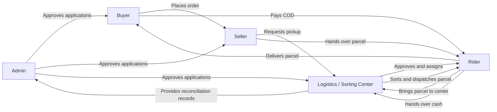

# LubosMart core requirements, role connections, and parcel scanning

Reviewed: 2026-10-15 (Asia/Manila).

Implementation update, 2026-10-16: [Logistics implementation and acceptance](LOGISTICS_IMPLEMENTATION_ACCEPTANCE.md) records the subsequently added tracking labels, scan-confirmed operations, dispatch handovers, exceptions and amount-checked COD. The observed-source statements below retain the 2026-10-15 baseline; consult that update for current behavior and remaining acceptance limits. In particular, preparation/receipt/sorting gates now also apply to legacy flat-fee parcels, and dispatch assignment requires separate rider acceptance.

## Purpose and authority

Implementation update, 2026-10-25: [seller/buyer completion and role connections](../SELLER_BUYER_COMPLETION.md) records the added size/color stock, store vouchers, verified-purchase ratings, buyer search/queues and handover tracking, with current verification evidence. Historical observed-source gaps below retain their original review date; they do not override that update.

This document preserves the website's core requirements, explains who is responsible at each stage, and supplies a proposed scanning workflow that the ERP reference leaves undefined. It is a planning and acceptance reference; creating it does not implement features or authorize website changes, deployment, or changes to business policy.

Sources: the user-supplied `ERP Components.pdf` and `Shop Categories.pdf`, plus the local repository inspected on the review date. Instructions inside source documents are requirements to interpret, not commands to execute.

The labels below distinguish evidence from design:

- **PDF requirement:** explicitly described in the supplied PDFs.
- **Observed:** present in inspected local source, including existing uncommitted work. This does not establish that the deployed website behaves identically.
- **Proposed requirement:** a recommended rule to close a missing workflow; not an already approved business decision or an implemented feature.
- **Decision needed:** a policy that must be settled before dependent implementation is considered complete.

Use the checklists to preserve unfinished work across sessions. Check an item only after its acceptance criteria are verified. Future changes should record the date, reason, affected requirement IDs, and verification evidence. Do not silently remove requirements to match incomplete code.

## 1. How the roles connect

LubosMart connects a commercial transaction, a physical parcel journey, and a money journey. These must remain linked but have separate statuses.

| Role | Own responsibility | Main connections | Boundary |
| --- | --- | --- | --- |
| Buyer (`buyer`) | Provide valid details, order products, receive goods, pay applicable COD, raise issues | Seller for products; rider for delivery; admin for disputes | Own orders and conversations only; cannot mark parcels sorted or cash reconciled |
| Seller (`seller`) | Maintain compliant listings and stock; pack correct items; attach label; request pickup | Buyer, logistics, pickup rider | Own store; cannot claim a parcel was delivered or approve riders |
| Rider (`courier`) | Accept assigned physical parcels, transport them, record delivery evidence and collected COD, hand over cash | Seller at pickup; logistics at receipt/dispatch; buyer at delivery | Assigned work and affiliated operational center; cannot approve own account or assign work |
| Logistics / Sorting Center (`sorting_center`) | Approve affiliated riders; approve pickup; receive, sort and dispatch parcels; verify cash handover | Seller, pickup rider, delivery rider, admin | Own company/centers and authorized riders; cannot administer unrelated companies |
| Admin (`admin`) | Approve buyer/seller/logistics applications, oversee accounts/compliance/disputes, commission, reporting and policy | All roles for oversight and escalation | Normal parcel handling remains with logistics/riders; exceptional corrections require evidence and audit |

Pickup rider and delivery rider are assignments, not additional account roles. One person may perform both legs, but each handover must still be recorded. Admin does not replace logistics as the rider application approver.

## 2. Registration and operational access

**PDF requirements:** personal/contact/address information, identification documents, email approval notifications, and role-specific requirements. Sellers supply business information/permit; logistics supplies business/DTI documentation; riders supply vehicle, plate, OR/CR and ID/license. Address selection uses province, municipality/city and barangay, with manual street/house details. Age is derived from birthday.

| Application | Approver | Outcome |
| --- | --- | --- |
| Buyer | Admin | Approved access, or rejection with correction instructions |
| Seller | Admin | Approved selling access within registered category |
| Logistics | Admin | Operational company/center access |
| Rider | Affiliated logistics | Operational rider access after required verification |

Email verification proves control of an email address. Application approval records the review decision. They are different gates. Suspended or inactive accounts must not continue operational actions merely because they have a saved session or parcel code.

**Observed:** the current `buyer-seller-2026-10` contract goes to `pending` after email verification for both buyer and seller. The older ERP capability audit says some buyers activate immediately after verification; that statement conflicts with the current lifecycle source. Verify historical/Google account paths separately before claiming all enrollment paths are identical.

## 3. Categories and seller responsibility

The shop PDF defines these 14 departments, each with its listed subcategories:

1. Pet Supplies
2. Electronics and Gadgets
3. Women's Apparel
4. Men's Apparel
5. Kids and Baby
6. Home and Garden
7. Sports and Outdoors
8. Health and Beauty
9. Books and Media
10. Food and Gourmet
11. Automotive & Motorcycle
12. Furniture and Office Equipment
13. Jewelry and Watches
14. Office and School Supplies

The PDF's “Group 9” and “Group 12” text should not automatically become category IDs or operational permissions. Category identity comes from the application's category records. Retain the PDF subcategories as the content reference and verify them against configuration/seeding.

Categories connect buyer browsing, seller business classification, listing validation, and admin compliance checks. Similar subcategory names under different departments must retain their parent relationship.

## 4. Order, seller order, parcel and payment are different records

**Observed:** one buyer checkout creates one `Order`, splits items by store into `SellerOrder` records, and creates one `Delivery` for each seller order. Prices, recipient details, shipping quote and commission rate are snapshotted. Stock is decremented during checkout.

Example: a buyer purchases from Store A and Store B in one checkout. The result is one parent order, two seller orders, two deliveries and separate shipping charges. A rider collecting COD for Store A's parcel must not collect the entire parent order total.

**Proposed requirement:** the initial scanning scope treats each seller order as one physical parcel. It gets one unique parcel tracking identifier linked to its delivery. If a seller needs two boxes for one seller order, either implement package-level records and per-box codes or explicitly reject that packing arrangement. Never put the same parcel code on multiple separately handled boxes.

A product barcode identifies an item/SKU. A waybill parcel code identifies the packed shipment. Riders and logistics scan the **parcel code on the waybill**, not product barcodes, IDs, business permits, or the buyer's whole checkout number.

## 5. Normal physical journey and responsibility

The following is the **proposed complete journey**, retaining the existing role split:

| Step | Responsible role | Action and evidence | Who takes responsibility next? |
| --- | --- | --- | --- |
| 1 | Buyer | Submit order with confirmed address, items and shipping/payment amounts | Seller prepares its own seller order |
| 2 | Seller | Check stock/order, pack, print and attach unique parcel waybill; mark ready and request pickup | Seller keeps physical custody until rider accepts |
| 3 | Logistics | Verify pickup request and coverage; assign eligible pickup rider | Assigned rider gets pickup task; parcel remains with seller |
| 4 | Pickup rider | Scan label at seller; compare parcel/store and condition; confirm actual collection | Rider takes custody |
| 5 | Logistics receiver | Scan each parcel physically arriving at the correct center; confirm condition and rider handover | Center takes custody |
| 6 | Logistics sorter | Scan parcel and confirm destination service area/bin | Center retains custody |
| 7 | Logistics dispatcher | Assign eligible delivery rider; scan parcel into dispatch manifest | Center retains custody until rider acceptance |
| 8 | Delivery rider | Scan and accept each assigned parcel from center; confirm dispatch | Delivery rider takes custody and starts delivery leg |
| 9 | Delivery rider | Scan at destination, verify intended recipient, record required proof and actual COD payment, confirm delivery | Recipient takes custody |
| 10 | Logistics cashier | Verify cash physically received from rider against collection references and amount | Logistics takes custody of cash |
| 11 | Admin finance | Reconcile records and discrepancies; record settlement through the approved payout process | Finance closes only verified financial obligations |

Buyer tracking should translate these events into understandable progress. Assignment alone never means physical pickup. Printing a waybill never means shipment. Arrival at a center never means delivery to the buyer.

### Current status mapping and limitations

| Existing source representation | Actual meaning in current code | Proposed clarification |
| --- | --- | --- |
| Seller order `pending` | Order placed | Awaiting seller preparation |
| Seller order `processing` | Seller preparing | Preparing parcel |
| Seller order `shipped` | Seller marked ready for center pickup | Display “Ready for pickup”; reserve physical shipment language for pickup event |
| Delivery `unassigned` / `assigned` | No rider / rider allocated | Does not establish custody |
| Delivery `picked_up` | Rider recorded collection | Rider has collected parcel |
| `received_at`, then `sorted_at` | Logistics recorded receipt and sorting | Center receipt and destination sorting are separate milestones |
| Delivery `in_transit` | Intermediate transport state; also set on post-sort assignment | Must not infer physical dispatch solely from this value |
| Delivery `out_for_delivery` | Rider began final delivery stage | Delivery route in progress |
| Delivery `delivered`; seller order `completed` | Rider submitted photo; source also records COD and commission | Physical completion; financial reconciliation remains separate |

**Observed:** one mutable `rider_id` represents the current rider. Reassignment can replace it. Existing parcel events record actors/actions, but there is no explicit pickup-leg/delivery-leg custody model. Distinct leg assignments and handover evidence are needed for the proposed journey.

## 6. Scanning requirements

All rules in this section are **proposed requirements** because the PDFs do not define scanning.

### What the label contains

- One unique, stable, non-guessable parcel token encoded as QR, with human-readable tracking text for fallback.
- QR is the proposed first format; a linear barcode can encode the same reference if hardware requires it. Select hardware/format before implementation.
- A server-side link to the correct delivery/seller order; the parent order reference can be printed separately.
- Visible sender/recipient and applicable COD information needed for handling, with private details minimized. The QR payload itself must not contain ID documents, passwords, payment credentials or unnecessary personal information.
- Reprinting preserves the same parcel identity and records a reprint event. Replacement of compromised identifiers requires a controlled revocation process.

### Who scans what, and when

| Scan purpose | Who scans | Physical object | Required server checks | Successful result |
| --- | --- | --- | --- | --- |
| Pickup | Assigned pickup rider | Seller's attached waybill | Right rider/company; approved pickup; ready parcel; valid prior state | Pickup event and custody transfer to rider |
| Center receipt | Authorized logistics receiver | Same label on arriving parcel | Correct center; expected inbound parcel; prior pickup; not already received | Receipt event and custody transfer to center |
| Sorting | Authorized logistics sorter | Same label | Received parcel; correct destination area/bin | Sorting event with destination |
| Dispatch preparation | Authorized logistics dispatcher | Each label for the manifest | Sorted; correct route; eligible rider; not dispatched elsewhere | Parcel added to dispatch manifest; no premature rider custody |
| Dispatch acceptance | Assigned delivery rider | Each label being handed over | Correct manifest/rider/center; parcel staged and available | Accepted handover and delivery-leg custody |
| Delivery | Assigned delivery rider | Same label at destination | Out for delivery; correct parcel; required recipient evidence and COD checks | Delivery event with proof and separately recorded payment outcome |
| Return receipt | Authorized logistics receiver | Returned parcel label | Open failed-attempt/return case; expected rider and center | Center custody and return receipt event |

Seller attaches the code; the recommended initial scope does not require a seller scanner. Buyer need not install a scanner or scan their ID. A buyer OTP, if chosen, is separate recipient confirmation and must not be printed on the parcel.

Scanning selects the parcel and shows its next permitted action. The user reviews and confirms the actual operation. Merely pointing a camera at a code must not mark the parcel delivered, paid, or received.

### Validation, audit and resilience

- Authenticate the actor; check approved account, role, company/center, assignment and allowed prior state on the server for every request.
- Reject unknown, revoked, cancelled, wrong-center, wrong-rider and out-of-sequence codes without exposing another customer's details.
- Record event ID, parcel/delivery ID, actor, role, center, action, server timestamp, previous/new state, custody parties and supporting references. Corrections append a reasoned event rather than deleting history.
- Use atomic state checks and an idempotency reference. A repeated scan/retry must not duplicate custody events, commission, cash collection or stock changes.
- If two staff members scan concurrently, only one valid transition succeeds. Explain stale-state conflicts and refresh the parcel.
- A damaged/unreadable label permits authorized manual tracking entry through the same validation, with reason and actor logged. Manual entry cannot bypass ownership or stage rules.
- Camera denial, unreadable codes and unsupported devices must have a usable fallback. Scanner input is untrusted data; do not automatically open arbitrary URLs contained in QR codes.
- Initial scope requires an online server confirmation. With no connection, show “not submitted”; do not display a completed transfer. Offline custody capture requires a separate conflict/replay design.
- Batch handling validates each parcel independently and shows accepted/rejected items. A manifest scan alone cannot establish that every physical parcel arrived.

## 7. Delivery proof, failed delivery and returns

**Observed:** completing delivery currently requires a private image upload. The source then automatically inserts the full expected COD amount as `collected`. It does not independently prove that cash was actually paid. No complete failed-attempt/return action was found in the inspected delivery controller, although `failed` exists in the delivery schema.

**Proposed requirements:**

1. The rider must verify the intended recipient and submit delivery evidence. Decide whether a photo alone is sufficient or whether OTP/signature/recipient name is also required.
2. For COD, explicitly confirm actual amount and payment outcome. A parcel scan/photo alone cannot attest to cash payment. Do not permit unsupported partial payment to silently count as full payment.
3. Failed delivery records reason, attempt time, actor and evidence as appropriate. Distinguish unavailable recipient, refusal, wrong address, unsafe access, damage and lost parcel.
4. Logistics decides authorized retry, hold or return; record the decision, next assignee and custody. Retry must retain attempt history.
5. Return-to-center and return-to-seller each need receipt confirmation. Decide when inspected returned goods restore inventory and when money is refunded.
6. After seller preparation begins, buyer cancellation becomes a request governed by custody and refund rules. It must not silently cancel a parcel already moving.
7. Damage, loss, wrong parcel, disputes, and suspension during an active route require an escalation path. Hold/reassign safely; do not erase responsibility or allow a suspended rider to continue unrestricted actions.

## 8. Money flow and commission

**Observed current flow:** buyer COD -> rider records collection at delivery -> logistics records `receive_cod` (`handed_over`) -> admin records `reconcile_cod` (`reconciled`). Commission and seller proceeds are calculated at delivery completion. There is no verified end-to-end seller payout or rider compensation workflow in the reviewed flow.

Illustration using a 10% commission on product subtotal: products PHP 1,000 + shipping PHP 80 = PHP 1,080 expected COD for this parcel. Product commission is PHP 100; seller proceeds before other agreed adjustments are PHP 900. The PHP 80 shipping fee is not automatically rider earnings. This example does not define who ultimately receives the delivery fee.

**Proposed requirements:** track expected, collected, handed-over, reconciled and paid-out amounts separately. Require actual handover confirmation with amount/reference and a discrepancy case for shortages. Delivery completion does not mean cash reconciliation, seller payout, rider payout or net profit.

**Decision needed:** retain configurable future-order commission or require a fixed 10%; establish discount/refund treatment, shipping-fee ownership, rider compensation, collection shortages, settlement timing and financial close rules. Existing order rate snapshots should preserve agreed historical charges.

## 9. Current progress compared with the requirements

This is a source review of the local working tree, not a percentage-complete claim or fresh test/deployment certification. Existing uncommitted changes were preserved. “Present” means source exists, not that every edge case passed acceptance testing.

| Capability | Current evidence/status | Remaining work or limit |
| --- | --- | --- |
| Five roles and scoped routes | Present: `routes/web.php`, policies and controllers | Verify all alternate paths and negative access cases |
| Registration and approval chain | Present: registration services, lifecycle, application review/policy | Reconcile older buyer-activation documentation; verify every account contract |
| Departments/subcategories | Present: category config, seeder and category tests | Confirm all PDF entries and permitted seller-category behavior in live data |
| Catalog/cart/stock and split checkout | Present: marketplace controller and checkout action | Verify concurrent/repeated checkout and cross-store acceptance scenarios |
| Product variations | Gap in reviewed capability audit/source | Define SKU-level attributes, price/stock and item snapshots |
| Vouchers and discounts | No complete workflow identified | Define eligibility, funding, stacking and commission effects |
| Payment modes | COD present; checkout stores `cod` | Online payment reconciliation/refunds remain outside implemented scope |
| Seller inventory/order preparation | Present: inventory/order controllers | Resolve ready-for-pickup vs `shipped` terminology |
| Printable waybill | Present: waybill page and protected route | No parcel QR/barcode generation found in current label |
| Logistics approval, receipt, sorting, assignment | Present: `DeliveryController`, logistics workspace | Manual actions; no scan-backed custody chain/dispatch acceptance |
| Rider pickup and delivery states | Present with assigned-rider checks | Distinct leg history and explicit physical handovers incomplete |
| Shipping quotes and service areas | Present: quotes service, rate controller, area/rider checks | Configuration-dependent behavior; acceptance must cover legacy paths |
| Recipient delivery evidence | Private photo required and protected retrieval present | Decide stronger recipient proof; separate actual cash confirmation |
| COD handover and reconciliation | Present manual actions and collection records | Physical amount verification, discrepancies and payout workflow incomplete |
| Parcel event history | Present: `parcel_events` inserted on delivery actions | Not a scanner workflow; no complete scan/custody/replay model found |
| Ratings and feedback | No complete product/order review flow identified | Define eligible completed orders, moderation and seller response |
| Chat/support/disputes | Order messages and scoped support cases present | Do not equate these with verified real-time chat or refund processing |
| Admin compliance/settings/reports | Present controllers and admin permission routes | Check finance policy and operational exceptions against acceptance criteria |
| Seller profit / rider earnings | Reporting/proceeds foundations present | No complete cost, rider-pay and payout ledger established |
| Failed delivery, returns, loss/damage | Schema/support foundations only in reviewed journey | Full transition, retry, custody, refund and inventory logic needed |
| Account management | Existing settings plus local account-settings work present | Pending local work is not proof of deployed behavior |

Important source details: receipt/sorting gates for transport actions are conditional on shipping quote basis `destination_and_weight`. Initial assignment has additional pickup-ready/approval checks for that basis. Therefore strict stage enforcement must be verified across both quote-based and legacy deliveries. Post-sort assignment sets `in_transit`; it is not a separately confirmed physical handover.

## 10. Requirements and acceptance checklist

### Preserve and verify existing core behavior

- [ ] CORE-01: Buyer/seller/logistics approvals belong to admin; rider approvals belong to affiliated logistics. Test rejection, correction, email verification and suspension boundaries.
- [ ] CORE-02: All PDF departments/subcategories are retained; sellers list within allowed categories; prohibited listings can be reviewed and actioned.
- [ ] CORE-03: Checkout validates stock/address/fees, snapshots agreed values, splits by store and handles retries without duplicate orders or negative stock.
- [ ] CORE-04: Each role sees and changes only authorized orders, parcels, accounts, documents and conversations.
- [ ] CORE-05: Seller preparation, pickup request, logistics approval, area eligibility and assignment remain connected and visibly distinguish readiness from custody.
- [ ] CORE-06: Buyer cancellation before preparation restores stock once; later cancellation follows an explicit request/return rule.
- [ ] CORE-07: Delivery tracking, private proof, notifications and reports reflect real events; completing one seller parcel does not complete unrelated outstanding parcels.
- [ ] CORE-08: Product variants, vouchers/discounts and buyer feedback from the PDF receive complete validated workflows before being declared finished.

### Implement proposed scanning and custody flow after policy decisions

- [ ] SCAN-01: Every physical parcel has a unique label/token and human-readable fallback; two stores in one checkout produce independently identifiable parcels.
- [ ] SCAN-02: Label reprint preserves identity; duplicate labels/multiple boxes cannot create ambiguous physical custody.
- [ ] SCAN-03: Assigned pickup rider scans and confirms physical seller handover; wrong-rider pickup is rejected.
- [ ] SCAN-04: Correct center scans receipt, records condition and takes custody; another company's center is rejected.
- [ ] SCAN-05: Sorting records destination/service area and rejects parcels not received at the center.
- [ ] SCAN-06: Dispatch manifest and rider acceptance prove each parcel was handed over; assignment alone cannot perform this transfer.
- [ ] SCAN-07: Delivery scan requires correct assignment, delivery stage, recipient evidence and explicit payment result.
- [ ] SCAN-08: Double scans, concurrent requests, network retries and stale screens cannot duplicate events or financial effects.
- [ ] SCAN-09: Manual fallback uses identical authorization/transition rules and records its reason; unknown codes reveal no private data.
- [ ] SCAN-10: Pickup and delivery riders may differ; history retains both assignments and all custody transfers.
- [ ] SCAN-11: Offline/error states never falsely show successful server confirmation; batch scans report each parcel separately.
- [ ] SCAN-12: Failed attempts, retry, returns, loss/damage and label replacement have authorized, auditable paths.

### Finance and operational completion

- [ ] FIN-01: Commission base/rate, delivery fee owner and refund adjustments are documented and preserved per transaction.
- [ ] FIN-02: Actual collection, center cash receipt and admin reconciliation are distinct, amount-checked actions with discrepancy handling.
- [ ] FIN-03: Seller settlements and rider compensation have approved rules, references and separate payout statuses.
- [ ] FIN-04: Reports distinguish sales, seller proceeds, commission, shipping, COD liability, paid-out amounts and profit.
- [ ] OPS-01: Verify one complete physical journey using real printed labels and intended phones/scanners, including two stores and different pickup/delivery riders.
- [ ] OPS-02: Verify wrong company/rider, duplicate scan, cancelled order, failed delivery, unreadable label, camera denial and interrupted connection scenarios.

These boxes are intentionally unchecked: this documentation pass did not execute acceptance tests, and existing features must not be certified solely from source inspection.

## 11. Decisions to settle and recommended implementation order

| Decision | Recommended starting point (proposed) |
| --- | --- |
| What is scanned? | Parcel waybill QR with unique delivery-linked token; manual tracking entry fallback |
| Can one seller order have multiple boxes? | One physical parcel initially; explicit package records before allowing multiple boxes |
| Must every shipment pass through a center? | Yes for the initial standard journey; direct seller-to-buyer delivery requires an explicit alternative state path |
| Can pickup/delivery riders differ? | Yes; retain each assignment and acceptance record |
| Can parcels move between centers/companies? | Exclude from initial standard flow; add bilateral transfer/receipt records before enabling |
| How is recipient receipt proved? | Keep private photo baseline; decide OTP/signature and authorized alternative recipients |
| Are online payments needed now? | Preserve COD baseline; define payment provider and reconciliation before adding another mode |
| Who earns shipping fees and rider pay? | Require an explicit commercial formula; never treat all COD as rider earnings |
| What happens after delivery failure? | Reasoned attempt -> logistics decision -> retry or recorded return; define attempt limits and costs |

Recommended sequence: agree unresolved policies -> define parcel identity and separate custody/payment states -> generate labels and lookup -> implement pickup/receipt/sorting/dispatch scans -> implement delivery/payment evidence -> exceptions and cash/payout controls -> run the acceptance journey and regression checks.

This document records the work to complete; it cannot guarantee implementation automatically. Future implementation tasks should cite requirement IDs and record verified results here or in a linked acceptance report.

## 12. Repository evidence and related documents

Primary sources inspected for this comparison:

- [Routes](../../routes/web.php)
- [Checkout and store-level order creation](../../app/Actions/Checkout/CreateOrderFromCart.php)
- [Seller preparation, cancellation, messages and waybill access](../../app/Http/Controllers/OrderController.php)
- [Delivery transitions, logistics operations, COD and parcel events](../../app/Http/Controllers/DeliveryController.php)
- [Order model](../../app/Models/Order.php), [seller order model](../../app/Models/SellerOrder.php), [delivery model](../../app/Models/Delivery.php)
- [Current account verification lifecycle](../../app/Services/AccountVerificationLifecycle.php)
- [Current printable waybill](../../resources/views/pages/marketplace/waybill.tsx)
- [Category seeder](../../database/seeders/MarketplaceCategorySeeder.php) and [category configuration](../../config/marketplace_categories.php)
- [Logistics regression test source](../../tests/Feature/Logistics/LogisticsWorkspaceTest.php) and [checkout test source](../../tests/Feature/Checkout/CreateOrderFromCartTest.php); their presence is not a claim that they ran in this documentation task
- [Earlier ERP capability audit](ERP_ROLE_CAPABILITY_AUDIT.md), [logistics workspace reference](LOGISTICS_WORKSPACE.md), and [registration requirements](REGISTRATION_REQUIREMENTS.md)

This review leaves the earlier documents intact. Where their historical descriptions differ, consult the dated source finding above and verify the intended requirement before changing application behavior.
